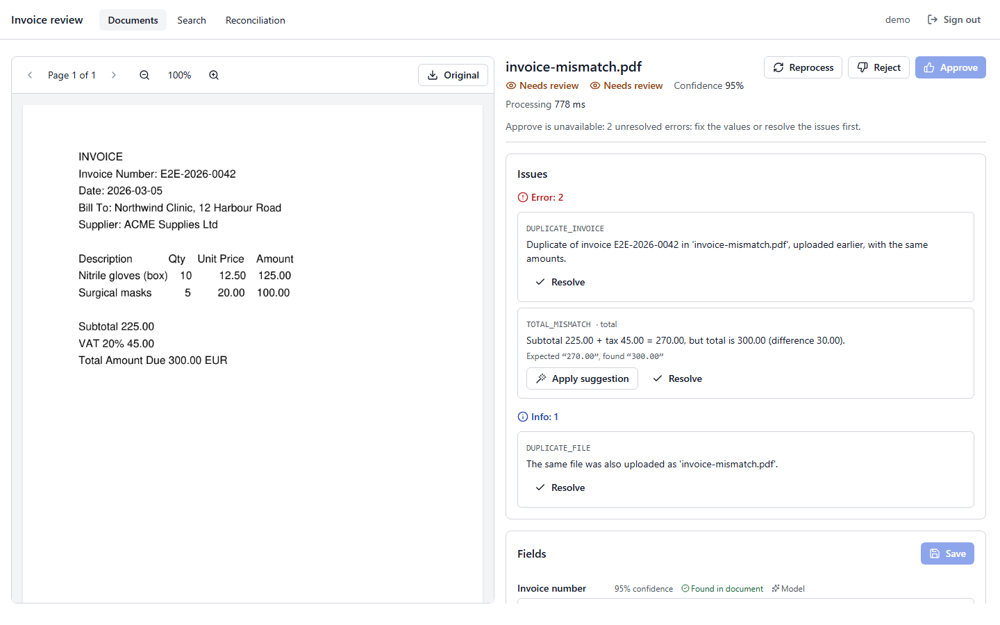
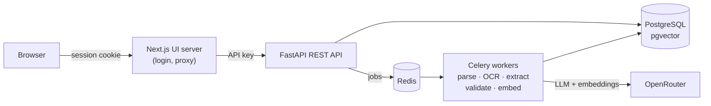

# Invoice Document Intelligence

Upload invoices as **PDFs, scans, photos, Excel or CSV files**, and get structured,
validated invoice data back, with a review screen for anything doubtful.

The system parses each file (with OCR where needed), splits files that contain
several invoices, extracts the fields with an LLM (or with rules for spreadsheets),
checks the result, makes it searchable, and sends anything uncertain to a human
reviewer. It **never invents values**: every field an LLM returns must be backed by
text found in the document, or it is rejected.



## Features

- **Every common format.** Digital and scanned PDFs, JPG/PNG/TIFF (including
  multi-page TIFF), XLSX/XLS and CSV in any common delimiter or encoding. Files up to
  2,000 pages are processed in parallel batches.
- **Robust OCR.** Tesseract, with deskew, upscaling, rotation detection and
  per-page choice between the PDF text layer and OCR.
- **LLM extraction you can trust.** Strict JSON schema, temperature 0, a grounding
  check on every value, confidence per field, prompt versioning, and a quota-aware
  gateway (rate limiter, daily budget, cache, model fallbacks, circuit breaker).
  Spreadsheets are extracted by rules with **zero** LLM calls.
- **Validation.** Totals and line sums (with rounding tolerance), dates, currency
  codes, duplicates across files, and PDF-to-spreadsheet cross-checks. Each issue
  explains the math and suggests a fix; validation never changes a value itself.
- **Review UI.** Page viewer with evidence highlighting, a field form that saves only
  changed values (with conflict detection), one-click suggestions, full version
  history, and a keyboard-only workflow.
- **Search.** Keyword, semantic and hybrid search over all invoices, with highlighted
  snippets; it falls back to keyword search when embeddings are unavailable.
- **Secure by default.** API keys with roles, rate limits, upload size and
  decompression-bomb limits, untrusted-input handling for document text. The browser
  never sees an API key.

## Architecture



Six containers: `frontend`, `api`, `worker`, `beat`, `db`, `redis`. The full
architecture, the processing flow and the design decisions are in
[docs/architecture.md](docs/architecture.md); the database schema is in
[docs/database.md](docs/database.md).

## Quick start

### Prerequisites

- **Docker Desktop** (or Docker Engine + Compose v2), with at least **4 GB** of
  memory for Docker: building the UI image and running OCR are memory-hungry.
- **Node.js 22+**, only to create the password hash in step 4.
- An **OpenRouter API key** (free tier works: https://openrouter.ai/keys).

### 1. Clone and configure

```bash
git clone https://github.com/SharifNirjon/careguidetask.git
cd careguidetask
cp .env.example .env
```

Open `.env` and set `OPENROUTER_API_KEY`. Keep `.env` private; it is gitignored.

### 2. Start the backend

```bash
docker compose up -d --build db redis api worker beat
docker compose exec -w /app/backend api alembic upgrade head
```

Wait until `docker compose ps` shows `api` as **healthy**. The API is now at
http://localhost:8000 (interactive docs at http://localhost:8000/docs).

### 3. Create an API key for the UI

```bash
docker compose exec api python -m app.cli api-key create --name review-ui --role reviewer
```

Copy the printed key into `.env` as `FRONTEND_API_KEY`. It is shown only once.

### 4. Set the UI login

```bash
# session secret: any 32+ random characters
node -e "console.log(require('crypto').randomBytes(32).toString('base64url'))"

# bcrypt hash of the password you want to sign in with (type it, then Enter)
cd frontend && npm ci && npm run hash-password && cd ..
```

In `.env`, set:

```ini
SESSION_SECRET=<the random string>
DEMO_USERNAME=demo
DEMO_PASSWORD_HASH=<the hash, with every $ written as $$>
```

Docker Compose treats `$` as a variable marker, so a hash like `$2b$12$abc…` must
be written `$$2b$$12$$abc…`. The script prints it in that form.

### 5. Start the UI

```bash
docker compose up -d --build frontend
```

Open **http://localhost:3000** and sign in with `demo` and your password.

### Try it

Generate some synthetic invoices and upload them in the UI:

The repository already contains four in `frontend/e2e/fixtures/`. To regenerate them,
or to build the full 74-file evaluation set, use the backend's Python environment
(see [Running the tests](#running-the-tests)):

```bash
python scripts/make_e2e_fixtures.py     # frontend/e2e/fixtures/
python -m eval.build_dataset            # eval/dataset/files/
```

`invoice-mismatch.pdf` has a total that doesn't add up, so it lands in **Needs
review** with a `TOTAL_MISMATCH` issue that you can fix with **Apply suggestion**.
Press `?` on the review screen for keyboard shortcuts.

Or use the API directly:

```bash
KEY=<an API key>
curl -H "Authorization: Bearer $KEY" -H "Idempotency-Key: $(uuidgen)" \
     -F files=@frontend/e2e/fixtures/invoice-mismatch.pdf \
     http://localhost:8000/api/v1/documents
curl -H "Authorization: Bearer $KEY" http://localhost:8000/api/v1/documents/<id>/results
```

See [docs/api.md](docs/api.md) and [docs/api.http](docs/api.http) for every endpoint.

## Command-line tools

All run inside the `api` (or `worker`) container:

| Command | Purpose |
|---|---|
| `python -m app.cli api-key create --name NAME --role viewer\|reviewer\|admin` | Create an API key (printed once) |
| `python -m app.cli api-key revoke KEY` | Revoke a key (the key or its `cg_xxxxxxxx` prefix) |
| `python -m app.cli llm-check [--probe]` | Show the remaining LLM quota and the configured models |
| `python -m app.cli ingest PATH [--sync]` | Ingest a file or a folder without the API |
| `python -m app.cli extract DOCUMENT_ID` | Re-extract one document and print every field |
| `python -m app.cli reembed --from-space SPACE` | Move embeddings from a fallback model to the primary |

## Running the tests

```bash
# backend: unit + integration (needs db and redis from docker compose)
cd backend && python -m venv .venv && . .venv/bin/activate   # Windows: .venv\Scripts\activate
pip install -r requirements.txt -r requirements-dev.txt && cd ..
pytest

# OCR tests (need Tesseract, which the worker image has)
docker compose run --rm worker pytest -m ocr

# frontend
cd frontend && npm test            # unit (Vitest)
npx playwright install chromium && npx playwright test   # e2e against the running stack

# test-results report (docs/test-results/summary.md)
python scripts/test_report.py
```

Latest results: **773 backend tests, 98 frontend unit tests and 13 evaluation-metric
tests pass; backend branch coverage 89 %**, see
[docs/test-results/summary.md](docs/test-results/summary.md). What each test covers:
[docs/testing/matrix.md](docs/testing/matrix.md).

## Evaluation

A seeded synthetic dataset (74 files, 119 invoices, every format, planted errors and
invalid files) and a harness that runs the real system end to end are in
[`eval/`](eval/). Results are generated from measured runs only:
[docs/EVALUATION.md](docs/EVALUATION.md) (the measured run is still pending).

## Project layout

```
backend/            FastAPI app, pipeline, LLM gateway, validation, search (Python 3.11)
  app/api/          REST API: routers, schemas, services
  app/pipeline/     intake, PDF / image / OCR / spreadsheet / CSV parsing, segmentation
  app/llm/          OpenRouter gateway: rate limits, quota, cache, fallbacks
  app/extraction/   prompts, grounding, normalization, rule-based spreadsheet extraction
  app/validation/   rules, duplicates, cross-document checks, reconciliation
  app/search/       chunking, embeddings, keyword / semantic / hybrid ranking
  app/models/       SQLAlchemy models and Alembic migrations
  app/workers/      Celery tasks
frontend/           Next.js review UI (TypeScript, Tailwind, TanStack Query)
tests/              backend tests (pytest)
eval/               evaluation dataset, runner and metrics
tools/synth/        seeded synthetic invoice generator
scripts/            benchmarks, fixtures, the test report
docs/               documentation (start with architecture.md)
```

## Documentation

| Topic | Document |
|---|---|
| Architecture and design decisions | [docs/architecture.md](docs/architecture.md) |
| Database schema (ER diagram) | [docs/database.md](docs/database.md) |
| Processing pipeline (PDF, OCR, images, Excel, CSV) | [docs/pipeline.md](docs/pipeline.md) |
| AI extraction and the LLM gateway | [docs/extraction.md](docs/extraction.md) |
| Validation rules | [docs/validation.md](docs/validation.md) |
| Search | [docs/search.md](docs/search.md) |
| REST API | [docs/api.md](docs/api.md), [docs/openapi.json](docs/openapi.json) |
| Review UI | [docs/frontend.md](docs/frontend.md) |
| Tests and results | [docs/testing/matrix.md](docs/testing/matrix.md), [docs/test-results/summary.md](docs/test-results/summary.md) |
| Benchmarks | [parsing](docs/benchmarks/parse.md), [search](docs/benchmarks/search.md) |
| Evaluation | [docs/EVALUATION.md](docs/EVALUATION.md) |
| Walkthrough recording script | [docs/walkthrough.md](docs/walkthrough.md) |
| AI-assisted development and prompts | [docs/AI_DISCLOSURE.md](docs/AI_DISCLOSURE.md) |

## Troubleshooting

| Symptom | Fix |
|---|---|
| `docker compose` returns "500 Internal Server Error" or a build hangs | Docker ran out of memory. Give Docker Desktop at least 4 GB (Settings → Resources), stop other containers, and restart Docker Desktop. |
| The UI loads without styling or the login button does nothing (Windows) | Use http://127.0.0.1:3000, or keep the default port binding: the UI is published on 127.0.0.1 to avoid Docker Desktop's unreliable IPv6 forwarding. |
| Uploads stay in **Queued** | The worker isn't running: `docker compose up -d worker` and check `docker compose logs worker`. |
| Documents wait with `LLM_QUOTA_DEFERRED` | The daily free LLM quota is used up (`python -m app.cli llm-check`). They resume automatically after the UTC reset. |
| Login fails right after setup | Check that `DEMO_PASSWORD_HASH` has every `$` doubled, then `docker compose up -d frontend` again. |

## Notes

- **Use synthetic or public documents only** with the free OpenRouter models: free
  endpoints may log traffic.
- **AI-assisted development.** This project was built with Claude Code from detailed
  step prompts; see [docs/AI_DISCLOSURE.md](docs/AI_DISCLOSURE.md) for what that
  means, the prompts used, and how AI is used inside the application.
