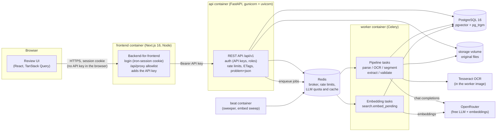
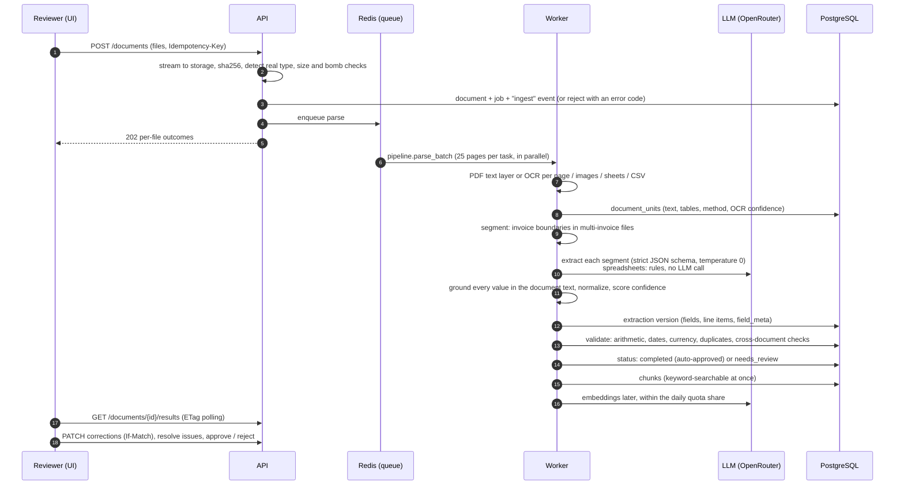
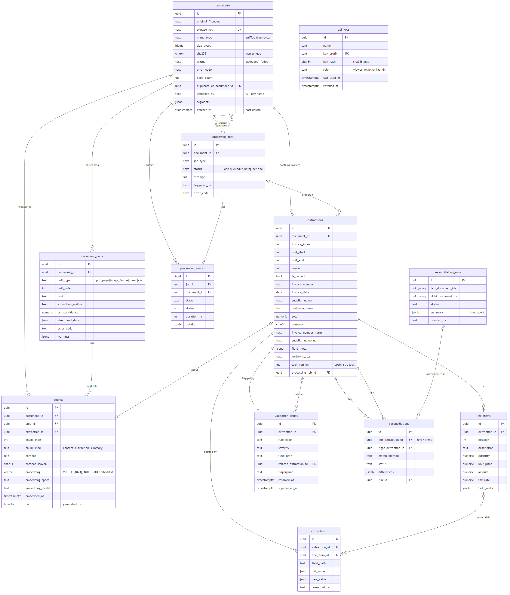

# Architecture

An invoice document-intelligence system: upload PDFs, scans, images, Excel and CSV
files; the pipeline parses them (OCR where needed), splits multi-invoice files,
extracts invoice fields with an LLM (or with rules for spreadsheets), validates them,
indexes them for search, and sends anything doubtful to a human reviewer.

## Components

| Container | Image | Responsibility |
|---|---|---|
| `frontend` | `frontend/Dockerfile` (Node 24, standalone Next.js, non-root) | The review UI and its server: login, sessions, a proxy that only forwards allowlisted API paths and adds the API key server-side. |
| `api` | `backend/Dockerfile` | The public REST API ([api.md](api.md), [openapi.json](openapi.json)). Uploads are streamed to storage, registered, and queued. |
| `worker` | `backend/Dockerfile` (with Tesseract) | Celery worker on the `ocr`, `default` and `llm` queues: the processing pipeline and embeddings. |
| `beat` | `backend/Dockerfile` | Exactly one scheduler: stale-job sweeper (`WORKER_TIMEOUT`), embedding sweep, re-embedding. |
| `db` | `pgvector/pgvector:pg16` | All state: documents, units, extractions (versioned), issues, events, chunks with vectors. |
| `redis` | `redis` | Celery broker, API rate limits, LLM daily quota and rate limiter, LLM response cache. |

## Processing flow

Every stage writes a `processing_events` row (stage, status, duration), so the
timeline in the UI and the processing-time statistics come from the same data. Stages
are idempotent: a retried or redelivered task creates no duplicate rows.

## Key design decisions

| Decision | Why |
|---|---|
| **Backend-for-frontend** instead of calling the API from the browser | The API key never reaches the browser; sessions are httpOnly cookies; the proxy allowlists paths and checks the origin on mutations. |
| **Celery stages with page batches** | OCR is slow (seconds per page); a 1,000-page file is split into parallel 25-page tasks, and a failed batch retries cheaply. |
| **Text layer first, OCR only where needed** | Digital PDFs parse at about 1,500 pages/s; OCR runs at a fraction of a page per second ([benchmarks/parse.md](benchmarks/parse.md)). |
| **Rules for spreadsheets, LLM for documents** | Clean tables need no model and cost no quota; the LLM handles free-form layouts. |
| **Grounding check on every LLM value** | The model must cite evidence found in the document; anything else is rejected, so values are never invented. |
| **Validation never changes values** | It reports issues with the computed expectation; a human applies a suggestion. |
| **Versioned extractions, append-only corrections and events** | Full audit history; optimistic locking (ETag / If-Match) protects concurrent reviewers. |
| **Quota-aware LLM gateway** | Shared rate limiter and daily quota in Redis, response cache, model fallbacks, circuit breaker; quota exhaustion defers work instead of failing it. |
| **PostgreSQL for search** (tsvector + pgvector HNSW + RRF) | One database, transactional consistency, filters in SQL; the HNSW index finds 0.968 of the exact top 10 at the default `ef_search` = 100 ([benchmarks/search.md](benchmarks/search.md)). |

## Database schema

The full schema (tables, constraints, indexes, the entity-relationship diagram) is in
[database.md](database.md).

## Further reading

| Area | Document |
|---|---|
| Ingestion and parsing pipeline (PDF, OCR, images, Excel, CSV) | [pipeline.md](pipeline.md) |
| AI extraction and the LLM gateway | [extraction.md](extraction.md) |
| Validation rules and the review policy | [validation.md](validation.md) |
| Search | [search.md](search.md) |
| REST API | [api.md](api.md) |
| Review UI | [frontend.md](frontend.md) |
| Tests and results | [testing/matrix.md](testing/matrix.md), [test-results/summary.md](test-results/summary.md) |
| Evaluation | [EVALUATION.md](EVALUATION.md) |
