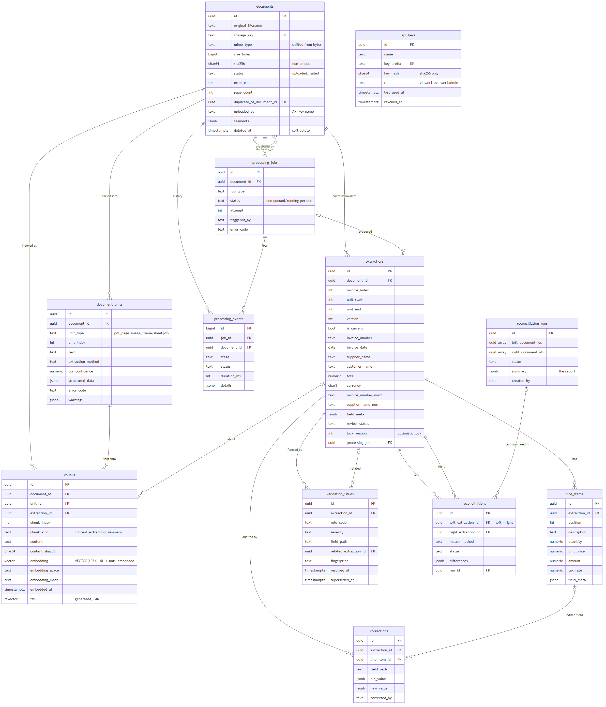
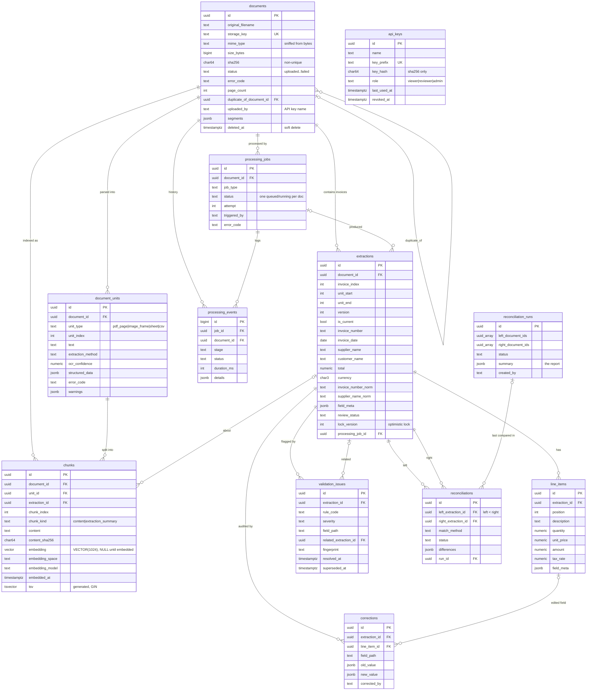
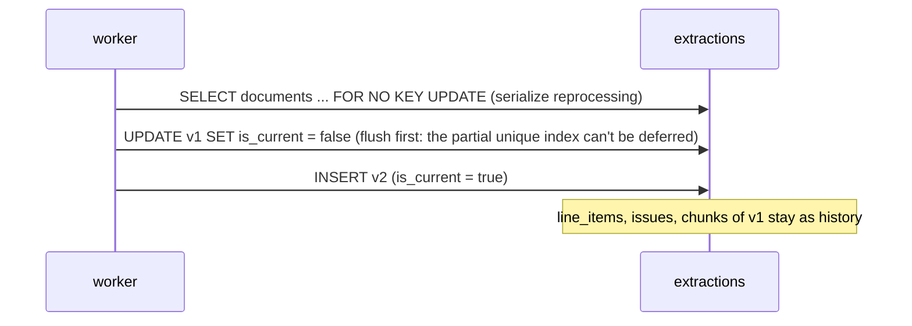
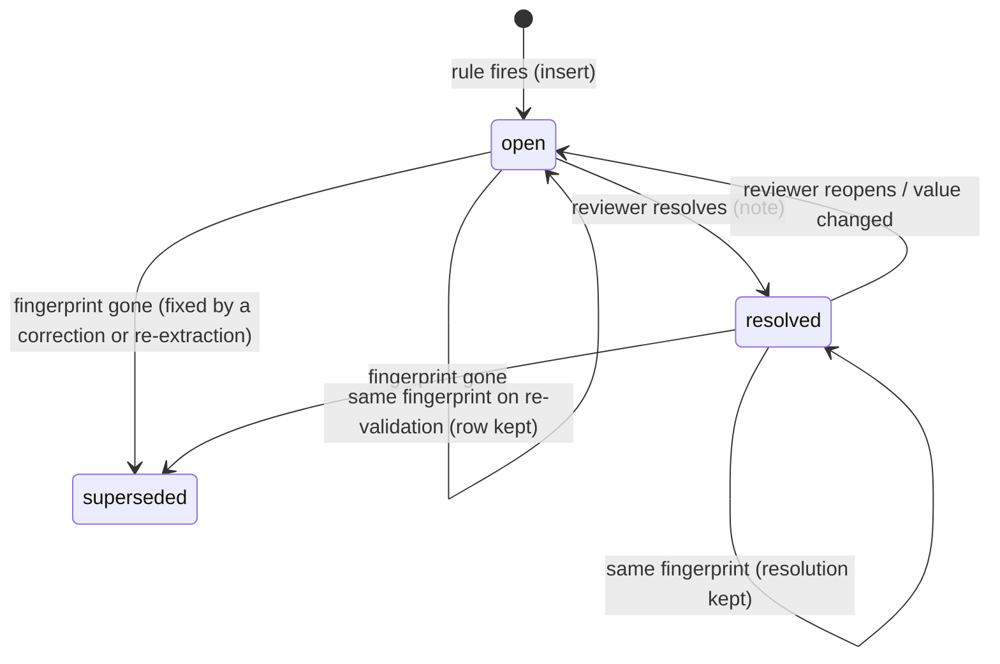

# Database

PostgreSQL 16 + pgvector 0.8 + pg_trgm, accessed through SQLAlchemy 2.x (sync, psycopg 3).
Schema changes go through Alembic only. This page describes the **final schema after
migrations 0001–0006** (Steps 2–7).

| What | Where |
|---|---|
| ORM models | `backend/app/models/` |
| Migrations | `backend/app/models/migrations/versions/` |
| Engine / sessions | `backend/app/db/session.py` |
| Extraction versioning helper | `backend/app/db/versioning.py` |
| Seed data | `backend/app/db/seed.py` |
| Tests | `tests/db/` (schema), `tests/search/` (search model) |

## Quick start

```bash
docker compose up -d db                      # pgvector/pgvector:pg16
cp .env.example .env                         # then export the variables
cd backend
pip install -e ".[dev]"
alembic upgrade head
python -m app.db.seed                        # optional sample data
cd .. && pytest tests/db                     # creates/drops careguide_test*
```

## Entity–relationship diagram



Rendered from the Mermaid source below (`docs/images/schema.mmd`) with mermaid-cli:

```bash
npx -y @mermaid-js/mermaid-cli@11.4.2 -i docs/images/schema.mmd -o docs/images/schema.png -w 2400 -b white
```

If mermaid-cli can't run (it downloads a headless Chromium), paste the block below into
<https://mermaid.live>, export PNG, and save it as `docs/images/schema.png`.



`api_keys` has no foreign keys on purpose: audit columns (`uploaded_by`, `corrected_by`,
`resolved_by`, `reviewed_by`, `triggered_by`, `created_by`) store the key's **name**, so
history stays readable after a key is revoked or deleted.

## Tables and their indexes

Every FK is the leading column of a full (non-partial) index, so cascades never scan
(`tests/db/test_constraints.py` checks the catalog). Primary keys (`pk_*`) are not repeated
below.

### documents

One row per uploaded file: what was uploaded (`original_filename`, `mime_type` sniffed from
the bytes, `size_bytes`, `sha256`), where it is stored (`storage_key`), who uploaded it, and
the file's pipeline state (`status`, `error_code`, `processing_*_at`). Re-uploads of the
same bytes are new rows linked through `duplicate_of_document_id`. Invoice boundaries from
the segmenter are in `segments`. Rows are soft-deleted with `deleted_at`; a hard `DELETE`
cascades to everything below and is only for retention or GDPR purges.

| index | why |
|---|---|
| `uq_documents_storage_key` | one row per stored blob |
| `ix_documents_sha256` (non-unique) | byte-identical duplicate lookup at intake |
| `ix_documents_status_created_at (status, created_at DESC)` | the review queue: "needs_review, newest first" |
| `ix_documents_duplicate_of_document_id` | FK index |

### document_units

The smallest parsed unit: a PDF page, an image or TIFF frame, a sheet, or a CSV file. It
holds the text, how it was obtained (`digital`, `ocr`, `spreadsheet`), OCR confidence, image
quality, and for sheets the normalized rows in `structured_data`. A unit that failed to
parse keeps its row with `error_code` set; non-fatal issues go in `warnings`.

| index | why |
|---|---|
| `uq_document_units_document_id_unit_type_unit_index` | re-parsing upserts in place (stable unit ids); also the FK index |
| `uq_document_units_id_document_id` | target of the chunks composite FK (keeps `chunks.document_id` consistent) |

### extractions

One invoice found in a document, one row **per extraction run** (see versioning below).
`field_meta` holds per-field provenance (`raw_value`, `confidence`, `evidence_text`,
`unit_index`, `source`: llm, rule or manual, `grounded`), plus `_document_type` and a
reviewer's `_review` decision. `lock_version` is SQLAlchemy's `version_id_col`.

| index | why |
|---|---|
| `uq_extractions_document_id_invoice_index_current` (partial `WHERE is_current`) | at most one live version per invoice |
| `uq_extractions_document_id_invoice_index_version` | version numbers never repeat; also the FK index |
| `uq_extractions_id_document_id` | target of the chunks composite FK |
| `ix_extractions_supplier_name_norm_invoice_number_norm` | exact duplicate check (same supplier + number) |
| `ix_extractions_supplier_name_norm_trgm` (GIN trigram) | fuzzy supplier matching (duplicates, the `supplier` filter, search) |
| `ix_extractions_customer_name_trgm` (GIN trigram on `lower(customer_name)`) | the `customer` filter (`lower() LIKE`) and customer search (0006) |
| `ix_extractions_invoice_date`, `ix_extractions_total` | range filters and sorting |
| `ix_extractions_review_status` | review-status filter and stats |
| `ix_extractions_processing_job_id` | FK index; makes a retried extraction job idempotent |

### line_items

The lines of one extraction version, ordered by `position`, with per-field `field_meta`.
`uq_line_items_extraction_id_position` keeps positions unique and is the FK index.

### validation_issues

Rule violations of an extraction: `rule_code`, `severity`, `field_path`, expected vs actual
values, and `related_extraction_id` for duplicates and cross-document checks. See the
issue lifecycle below.

| index | why |
|---|---|
| `uq_validation_issues_extraction_id_fingerprint_active` (partial `WHERE superseded_at IS NULL`) | one ACTIVE issue per fingerprint; backstop for concurrent re-validation |
| `ix_validation_issues_extraction_id_active` (partial) | "open issues of this extraction", the hot path |
| `ix_validation_issues_extraction_id` (full) | FK index: a cascade must also find superseded rows |
| `ix_validation_issues_related_extraction_id` | FK index (SET NULL) |
| `ix_validation_issues_rule_code_severity` | `rule_code` filter and the "issues by rule" stats |

### corrections

The append-only audit trail of manual edits (see below). `ix_corrections_extraction_id`
serves the correction history; `ix_corrections_line_item_id` is the FK index.

### reconciliations

Cross-document verification of two extractions, PDF↔PDF or PDF↔Excel. It records the match
method, the status and the field-level `differences`, stored in canonical order (`left <
right`, enforced by a CHECK). `run_id` names the batch run that last compared the pair.

| index | why |
|---|---|
| `uq_reconciliations_left_extraction_id_right_extraction_id` | one row per pair (upserted); also the left FK index |
| `ix_reconciliations_right_extraction_id` | FK index; "reconciliations of this extraction" from either side |
| `ix_reconciliations_run_id` | FK index (SET NULL) |

### reconciliation_runs

A user-requested batch check of one document set against another (PDFs vs an Excel
ledger). The full report is kept in `summary`, with these keys: matched, mismatched,
only_in_left, only_in_right, ambiguous, counts. The API creates the row first, so the
caller gets a `run_id` at once, then a Celery task fills it in.

### processing_jobs

One row per attempt to process a document (`full`, `reprocess`, `reextract`, `revalidate`,
`reembed`), with status, attempt number, who triggered it and any error.

| index | why |
|---|---|
| `uq_processing_jobs_document_id_active` (partial `WHERE status IN ('queued','running')`) | at most one active job per document; a concurrent reprocess gets 409 even under a race (0005) |
| `ix_processing_jobs_document_id_queued_at (document_id, queued_at DESC)` | "latest job of this document"; also the FK index |
| `ix_processing_jobs_status` | the stale-job sweeper and stats |
| `ix_processing_jobs_celery_task_id` (non-unique) | Celery retries reuse the task id |
| `uq_processing_jobs_id_document_id` | target of the events composite FK |

### processing_events

The processing history: one append-only row per stage transition (`ingest` … `embed`), with
its duration and details. It is the highest-volume table, so its key is a BIGINT identity.
`document_id` is copied onto each row, and a composite FK to `processing_jobs(id,
document_id)` keeps the copy honest.

| index | why |
|---|---|
| `ix_processing_events_document_id_created_at` | one document's timeline (API events, progress); also the FK index |
| `ix_processing_events_job_id` | events of one job (progress of the latest job) |

### chunks (the search model)

Searchable spans of text. There are two kinds (`chunk_kind`):

- **`content`**: one unit's text, packed by lines with overlap. Sheet and CSV chunks repeat
  their header row.
- **`extraction_summary`**: one per current extraction, generated from its normalized fields,
  for example "Invoice INV-2026-001 from Acme Ltd to Beta Corp, dated 2026-03-01 (March
  2026), total 1,234.56 USD. Items: …".

Every chunk has a generated full-text column `tsv`. It uses the 'simple' parser, and `-` and
`/` between letters or digits are read as spaces, so `INV-2026-001` is indexed as `inv 2026
001`. The `embedding` vector stays NULL until the embed task runs. Vectors live in **spaces**:
a space is one model's output, and two spaces are never compared.
`(embedding IS NULL) = (embedding_model IS NULL) = (embedding_space IS NULL) = (embedded_at
IS NULL)` is enforced by CHECKs, and `content_sha256` lets re-chunking keep the embedding of
unchanged text.

| index | why |
|---|---|
| `ix_chunks_embedding_hnsw_<space>` (HNSW cosine, partial `WHERE embedding_space = '<space>'`), one per space in `EMBEDDING_SPACES` | k-NN within one space. A vector query always names its space; per-space graphs never mix incomparable vectors (0006) |
| `ix_chunks_tsv` (GIN) | full-text search |
| `ix_chunks_pending_embedding` (partial `WHERE embedding IS NULL`) | the embedding work queue: small, and only the rows still to do (0006) |
| `ix_chunks_document_id_chunk_index` | ordered per-document reads and re-chunking; also the FK index (0006) |
| `ix_chunks_unit_id`, `ix_chunks_extraction_id` | FK indexes (composite FKs to units / extractions) |

### api_keys

API credentials. Only `sha256(key)` is stored, and the key itself is shown once. Lookup goes
through the public `key_prefix` (`uq_api_keys_key_prefix`), then the hash is compared in
constant time. Keys are revoked with `revoked_at`, never deleted, and `last_used_at` is
written at most once a minute.

## Versioning, lifecycle and audit

### Extraction versions

Reprocessing (a new model, a new prompt, fixed OCR) must not destroy the previous result.
Each run inserts `version = n+1`, and `add_extraction_version` flips the previous row's
`is_current` to false in the same transaction:



The ORM flip bumps `lock_version`, so a reviewer still editing v1 gets a conflict (409 or
412), never a silent write to history. Every read filters `is_current`.

### Issue lifecycle (fingerprints)

Re-validation computes the new issue set and diffs it against the ACTIVE issues by
fingerprint, `sha256(rule_code | field_path | related_extraction_id)`:



Unchanged issues keep their row, so a reviewer's resolution survives re-validation. Rows
are never deleted.

### Audit trail

- **`corrections`**: one row per changed field: old and new value (JSONB, decimals as
  strings), who and why. Writes happen in the same transaction as the change and its
  re-validation.
  - **Append-only:** a trigger raises `restrict_violation` on UPDATE.
  - **Line-item deletes:** the one allowed update is the `ON DELETE SET NULL` of
    `line_item_id`, so deleting a line item keeps its history.
- **`processing_events`**: append-only (trigger).
- **Who did what:** audit columns everywhere hold the authenticated API key's name, never
  a value from a request body.

## Conventions

- **Keys:** UUID primary keys with `DEFAULT gen_random_uuid()`, except `processing_events.id`
  (BIGINT identity).
- **Time:** every timestamp is `timestamptz`.
  - `created_at` defaults to `now()`.
  - `updated_at` on `documents` and `extractions` is set by the `set_updated_at` trigger,
    so it stays correct for raw SQL too.
- **Numbers:** money and quantities are `NUMERIC(18,4)`, rates `NUMERIC(7,4)`, confidence
  `NUMERIC(4,3)` with `CHECK 0..1`. They map to Python `Decimal`, and the API sends them as
  strings. There is no float anywhere.
- **Enum-like columns:** `TEXT` + `CHECK (col IN (...))`, each mirrored by a `StrEnum` in
  `app/models/enums.py`. A test asserts the two match; there are 18 such columns.
- **Names:** `pk_`, `fk_`, `uq_`, `ck_`, `ix_` via the MetaData naming convention, checked
  by a test.
- **Deletes:** `ON DELETE CASCADE` from `documents` downward. Optional back-references use
  `SET NULL`.

## Design decisions and trade-offs

**UUID primary keys.**

- **Why:** IDs can be generated anywhere without a round trip, they are safe in URLs (not
  enumerable), and they merge cleanly across environments.
- **Cost:** 16-byte keys and random index inserts, which is negligible at thousands of
  documents per day.
- **If it ever matters:** switch the default to UUIDv7 (the column type stays the same).

**TEXT + CHECK instead of native ENUM.**

- **Why:** a CHECK is dropped and re-added in one transactional migration (`NOT VALID` +
  `VALIDATE` on big tables). An ENUM needs `ALTER TYPE`, and removing a value means
  recreating the type.
- **Cost:** the allowed values live in two places, kept in sync by a test.

**pgvector inside Postgres instead of a separate vector database.**

- **Why:** one system to run, back up and secure. Semantic search filters and joins on
  status, soft deletes, supplier and so on in one query, with no dual writes and no sync job.
- **Costs:**
  - **Memory-hungry builds:** HNSW builds need a lot of memory (raise
    `maintenance_work_mem`; use `CREATE INDEX CONCURRENTLY` in later migrations).
  - **Filtered queries:** a filtered vector query needs iterative scans (see
    `docs/search.md`).
  - **Shared resources:** vector work competes with OLTP for the same CPU and RAM.
- **When to move:** to a dedicated store only if vector volume or QPS outgrows a read
  replica.

**`EMBEDDING_DIM` and `EMBEDDING_SPACES` are schema.**

- **`EMBEDDING_DIM`** (1024) sets the `VECTOR(n)` type. Changing it needs a migration that
  alters the column and rebuilds the indexes, plus a full re-embed.
- **`EMBEDDING_SPACES`** lists the spaces that have a partial HNSW index. `LLMSettings`
  refuses an embedding model whose space isn't listed, and a new space needs a migration
  that creates its index.
- **Migrations hardcode both values and never import them:** migrations are snapshots.

**The `'simple'` full-text config, with code splitting.**

- **Why:** invoices are dense with identifiers, names and mixed languages. Stemmers mangle
  them, and an English stemmer is wrong for German invoices.
- **The code fix:** the 'simple' parser alone reads `INV-2026-001` as `inv`, `-2026`, `-001`
  (signed numbers), so neither `2026-001` nor `001` could match. The `tsv` expression
  therefore reads `-` and `/` between letters or digits as spaces, and queries go through
  `app.search.keyword.prepare_websearch()`, which applies the same rule and turns codes into
  phrases.
- **Trade-off:** weaker recall for natural-language queries ("invoices" doesn't match
  "invoice"). Semantic search covers that in hybrid mode.

**Duplicates are stored, not rejected.**

- **Why:** rejecting by hash loses who re-sent what, when and how, and it only catches
  byte-identical files.
- **How real duplicates are found:** at the invoice level (normalized supplier + number,
  plus trigram similarity). They are **flagged** for a human to decide.

**Sync SQLAlchemy for both the API and the workers.** One engine and session style serves
both. FastAPI runs `def` endpoints in a threadpool, and Celery workers are synchronous.

- **Pool sizing:** size the pool to the threadpool (`DB_POOL_SIZE` + `DB_MAX_OVERFLOW` ≥
  concurrent DB requests).
- **Engine settings:** `pool_pre_ping`, and a server-side `statement_timeout`.

## Retention and scale plan (documented, not implemented)

At thousands of documents per day, with up to ~1,000 pages each, `chunks` and
`processing_events` grow fastest, then `extractions` (versions) and `validation_issues`
(superseded rows).

**Monthly range partitioning of `processing_events` and `chunks` on `created_at`**, once
either reaches tens of millions of rows or vacuum and index maintenance start to hurt:

- **Primary keys:** in PG16 a partitioned table's PK and unique constraints must include the
  partition key, so the PK becomes `(id, created_at)`. No FK points *at* either table,
  which keeps this cheap.
- **Per-partition indexes:** HNSW, GIN and partial indexes become per-partition. Smaller
  graphs build faster and fit in memory. A vector query fans out across partitions (the
  planner merges them), so bound searches by date where the UI allows.
- **Creating partitions:** create them ahead of time with `pg_partman`, and detach old ones
  instead of running a `DELETE`.

**Retention:**

| data | keep | how |
|---|---|---|
| `processing_events` | 90 days hot, then archived | detach the monthly partition, `COPY` it to object storage (Parquet/CSV), drop it |
| superseded extraction versions + their line items | 1 year | nightly job deletes `is_current = false` versions older than a year (their issues cascade); keep rows referenced by `corrections` |
| superseded `validation_issues` | with their extraction version | cascade |
| `chunks` of soft-deleted documents | 30 days | purge job deletes them (the documents stay soft-deleted for audit) |
| soft-deleted `documents` + blobs | per customer contract, default 1 year | hard delete cascades; the blob is removed from storage in the same job |
| `corrections`, `api_keys` | lifetime of the account | audit trail |

**Before partitioning, cheaper steps:**

- a read replica for search and stats
- `fillfactor` and autovacuum tuning on `extractions` and `chunks` (frequent updates)
- the `processing_events` retention job alone

## Migrations

| # | what |
|---|---|
| 0001 | initial schema, triggers, extensions |
| 0002 | unit errors/warnings, document segments |
| 0003 | extraction job link, `VECTOR(1024)` + `embedding_space`, LLM error codes |
| 0004 | issue fingerprints, `reconciliation_runs` |
| 0005 | `api_keys`, one active job per document, `WORKER_TIMEOUT` |
| 0006 | chunk kinds, `content_sha256`, `embedded_at`, per-space partial HNSW, pending-queue index, customer trigram index, code-splitting `tsv` |

- **Config:** `alembic.ini` lives in `backend/`; the URL comes from `DATABASE_URL`.
- **Workflow:** run `alembic revision --autogenerate`, then **hand-review** the result.
  Autogenerate misses triggers, generated columns, partial and expression indexes, and
  operator classes. Enum-like columns render as `sa.Text()`.
- **Reversibility:** every migration is fully reversible. The round-trip and
  models-match-migrations tests enforce this.

## Example queries

Every `sql` block below is executed against seeded data by
`tests/db/test_search.py::test_docs_sql_examples_execute`. Bind parameters use SQLAlchemy
`:name` style. The application builds these queries with SQLAlchemy in `app/search/`; the
SQL here shows their shape.

### Keyword search

`:q` must go through `prepare_websearch()` (codes become phrases of their parts, matching
the `tsv` expression).

```sql
SELECT c.id, c.document_id,
       ts_rank_cd(c.tsv, websearch_to_tsquery('simple', :q)) AS rank,
       ts_headline('simple', c.content, websearch_to_tsquery('simple', :q)) AS snippet
FROM chunks c
JOIN documents d ON d.id = c.document_id AND d.deleted_at IS NULL
WHERE c.tsv @@ websearch_to_tsquery('simple', :q)
ORDER BY rank DESC
LIMIT :limit;
```

### Semantic search

The space is a **literal**, not a bind parameter: it must match a partial index predicate
at plan time. The `ORDER BY` must be `embedding <=> <constant>` for the HNSW index to be
used.

```sql
SELECT c.id, c.document_id, c.content,
       c.embedding <=> CAST(:query_embedding AS vector) AS cosine_distance
FROM chunks c
JOIN documents d ON d.id = c.document_id AND d.deleted_at IS NULL
WHERE c.embedding_space = 'nemotron-3.5-8b'
ORDER BY c.embedding <=> CAST(:query_embedding AS vector)
LIMIT :limit;
```

### Hybrid search (reciprocal rank fusion)

Take the top 50 from each method, score each chunk `1/(60 + rank)` per list, and sum. RRF
needs no score normalization (see `docs/search.md`).

```sql
WITH keyword AS (
    SELECT id, row_number() OVER (ORDER BY rank DESC) AS rnk
    FROM (
        SELECT c.id, ts_rank_cd(c.tsv, websearch_to_tsquery('simple', :q)) AS rank
        FROM chunks c
        WHERE c.tsv @@ websearch_to_tsquery('simple', :q)
        ORDER BY rank DESC
        LIMIT 50
    ) k
),
semantic AS (
    SELECT id, row_number() OVER (ORDER BY dist) AS rnk
    FROM (
        SELECT c.id, c.embedding <=> CAST(:query_embedding AS vector) AS dist
        FROM chunks c
        WHERE c.embedding_space = 'nemotron-3.5-8b'
        ORDER BY c.embedding <=> CAST(:query_embedding AS vector)
        LIMIT 50
    ) s
)
SELECT c.id, c.document_id, c.content,
       COALESCE(1.0 / (60 + k.rnk), 0) + COALESCE(1.0 / (60 + s.rnk), 0) AS rrf_score,
       k.rnk AS keyword_rank,
       s.rnk AS semantic_rank
FROM keyword k
FULL OUTER JOIN semantic s ON s.id = k.id
JOIN chunks c ON c.id = COALESCE(k.id, s.id)
JOIN documents d ON d.id = c.document_id AND d.deleted_at IS NULL
ORDER BY rrf_score DESC
LIMIT :limit;
```

### The embedding work queue

Served by the partial index `ix_chunks_pending_embedding`:

```sql
SELECT count(*) AS pending_chunks, count(DISTINCT c.document_id) AS documents
FROM chunks c
WHERE c.embedding IS NULL;
```

### Find duplicate invoices

Byte-identical uploads:

```sql
SELECT sha256, count(*) AS copies, array_agg(id ORDER BY created_at) AS document_ids
FROM documents
WHERE deleted_at IS NULL
GROUP BY sha256
HAVING count(*) > 1;
```

The same invoice in different files (uses
`ix_extractions_supplier_name_norm_invoice_number_norm`):

```sql
SELECT e.supplier_name_norm, e.invoice_number_norm, count(*) AS n,
       array_agg(e.id ORDER BY e.created_at) AS extraction_ids,
       array_agg(DISTINCT e.document_id) AS document_ids
FROM extractions e
JOIN documents d ON d.id = e.document_id AND d.deleted_at IS NULL
WHERE e.is_current AND e.invoice_number_norm IS NOT NULL
GROUP BY e.supplier_name_norm, e.invoice_number_norm
HAVING count(*) > 1;
```

Fuzzy candidates for one invoice: the same number with the supplier spelled differently.
This uses the trigram GIN index; `%` matches at `pg_trgm.similarity_threshold`, default
0.3.

```sql
SELECT e.id, e.document_id, e.supplier_name, e.total, e.invoice_date,
       similarity(e.supplier_name_norm, :supplier_norm) AS supplier_similarity
FROM extractions e
JOIN documents d ON d.id = e.document_id AND d.deleted_at IS NULL
WHERE e.is_current
  AND e.invoice_number_norm = :invoice_norm
  AND e.supplier_name_norm % :supplier_norm
ORDER BY supplier_similarity DESC;
```

### Fetch a document with its current extractions and open issues

```sql
SELECT d.id, d.original_filename, d.status, d.page_count,
       COALESCE(
         jsonb_agg(
           jsonb_build_object(
             'extraction_id', e.id,
             'invoice_index', e.invoice_index,
             'version', e.version,
             'invoice_number', e.invoice_number,
             'supplier_name', e.supplier_name,
             'total', e.total,
             'currency', e.currency,
             'review_status', e.review_status,
             'open_issues', (
               SELECT COALESCE(jsonb_agg(jsonb_build_object(
                        'id', vi.id, 'rule_code', vi.rule_code, 'severity', vi.severity,
                        'field_path', vi.field_path, 'message', vi.message)
                      ORDER BY vi.created_at), '[]'::jsonb)
               FROM validation_issues vi
               WHERE vi.extraction_id = e.id
                 AND vi.superseded_at IS NULL
                 AND vi.resolved_at IS NULL
             )
           ) ORDER BY e.invoice_index
         ) FILTER (WHERE e.id IS NOT NULL),
         '[]'::jsonb
       ) AS invoices
FROM documents d
LEFT JOIN extractions e ON e.document_id = d.id AND e.is_current
WHERE d.id = :document_id AND d.deleted_at IS NULL
GROUP BY d.id;
```
