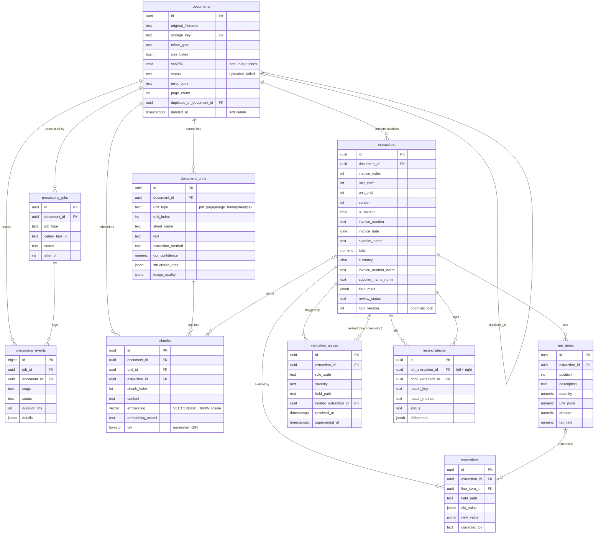

# Database

PostgreSQL 16 + pgvector + pg_trgm, accessed through SQLAlchemy 2.0 (sync, psycopg 3).
Schema changes go through Alembic only.

| What | Where |
|---|---|
| ORM models | `backend/app/models/` |
| Migrations | `backend/app/models/migrations/versions/` |
| Engine / sessions | `backend/app/db/session.py` |
| Extraction versioning helper | `backend/app/db/versioning.py` |
| Seed data | `backend/app/db/seed.py` |
| Tests | `tests/db/` |

## Quick start

```bash
docker compose up -d db                      # pgvector/pgvector:pg16
cp .env.example .env                         # then export the variables
cd backend
pip install -e ".[dev]"
alembic upgrade head
python -m app.db.seed                        # optional sample data
cd .. && pytest tests/db                     # creates/drops careguide_test*
```

## Entity–relationship diagram



## Tables

**documents.** One row per uploaded file. It records what was uploaded (`original_filename`, `mime_type` sniffed from the bytes, `size_bytes`, `sha256`), where it is stored (`storage_key`, unique), and the file's overall pipeline state (`status`, `error_code`, `processing_*_at`). Re-uploads of the same bytes are stored as new rows and linked through `duplicate_of_document_id`. Invoice boundaries found by the segmenter are stored in `segments` (JSONB, migration 0002). Rows are soft-deleted with `deleted_at`; a hard `DELETE` cascades to everything below and is only for retention or GDPR purges.

**document_units.** The smallest parsed unit: one PDF page, one image or TIFF frame, one spreadsheet sheet, or one CSV file. It holds the text, how the text was obtained (`digital`, `ocr` or `spreadsheet`), OCR confidence, image-quality metrics, and, for sheets, normalized rows in `structured_data`. `(document_id, unit_type, unit_index)` is unique, so re-parsing a document must replace its units rather than add to them. A unit that failed to parse keeps its row with `error_code` set (the rest of the document proceeds); non-fatal issues such as truncation or PDF repairs go in `warnings` (JSONB list). Added in migration 0002 by the ingestion pipeline (see docs/pipeline.md).

**extractions.** One invoice found inside a document, one row **per extraction run**. `invoice_index` identifies the invoice within the file, and `unit_start`/`unit_end` give its unit span. Reprocessing inserts `version = n+1` and flips the previous row's `is_current` to false in the same transaction (`app.db.versioning.add_extraction_version`). A partial unique index guarantees at most one current row per invoice. Invoice fields are nullable: a missing value is NULL, never a guess. `field_meta` holds per-field provenance (`confidence`, `evidence_text`, `unit_index`, `source`, `grounded`). `lock_version` is SQLAlchemy's `version_id_col`, so two reviewers saving the same row can't silently overwrite each other; the second gets `StaleDataError`.

**line_items.** The lines of one extraction version, ordered by `position`. They belong to a specific version, so a re-extraction produces a fresh set.

**validation_issues.** Rule violations found for an extraction (`rule_code`, `severity`, the `field_path` that failed, and expected vs actual values). For duplicates and cross-document mismatches, `related_extraction_id` points at the other invoice. Re-validation never deletes rows: it sets `superseded_at` on the old issues and inserts new ones. A reviewer closes an issue with `resolved_at`, `resolved_by` and `resolution_note`.

**corrections.** An append-only audit of every manual edit: which field, the old and new value (JSONB, with decimals stored as strings), who made it and why. A trigger blocks UPDATE. The one exception is the `ON DELETE SET NULL` of `line_item_id`, so deleting a line item keeps its history (`field_path` still says what changed).

**processing_jobs.** One row per attempt to process a document (`full`, `reprocess`, `reextract`, `revalidate` or `reembed`), with its Celery task id, status, attempt number, who triggered it and any error. `celery_task_id` is indexed but not unique, because Celery retries reuse the same id.

**processing_events.** The processing history: an append-only log with one row per stage transition (`ingest` … `reconcile`), giving duration and details. It is the highest-volume table, so its key is a BIGINT identity. `document_id` is copied onto each row so a document's timeline needs one index lookup. A composite FK to `processing_jobs(id, document_id)` makes it impossible for the copy to disagree with the job. `job_id` is nullable so events can be logged before a job exists.

**reconciliations.** Cross-document verification between two extractions: PDF↔PDF (for example an invoice and its copy) or PDF↔Excel (for example an invoice against an ERP export). It records how the pair was matched, whether it matched, and the field-level `differences`. The pair is stored in canonical order (`left < right`, enforced by a CHECK), so A–B and B–A can't both exist. Build rows with `Reconciliation.between(a, b)`.

**chunks.** The search index. Each chunk is a span of a unit's text, optionally tied to an extraction, with a pgvector `embedding` and a generated `tsv` column for full-text search. Composite FKs keep the copied `document_id` consistent with its unit and extraction.

## Conventions

- **Keys:** UUID primary keys with `DEFAULT gen_random_uuid()`, except `processing_events.id` (BIGINT identity).
- **Time:** every timestamp is `timestamptz`. `created_at DEFAULT now()`. `updated_at` (on `documents` and `extractions`) is set by the `set_updated_at` trigger, so it stays correct for raw SQL too; ORM `onupdate` only covers ORM flushes.
- **Numbers:** money and quantities are `NUMERIC(18,4)`, rates are `NUMERIC(7,4)`, and confidence is `NUMERIC(4,3)` with `CHECK 0..1`. They map to Python `Decimal`; there is no float anywhere.
- **Enum-like columns:** `TEXT` + `CHECK (col IN (...))`, each mirrored by a `StrEnum` in `app/models/enums.py`. A test asserts the two match.
- **Names:** deterministic `pk_`, `fk_`, `uq_`, `ck_`, `ix_` names via the MetaData naming convention. A test asserts every constraint and index follows it.
- **FK indexes:** every FK is the leading column(s) of a full (non-partial) index; a test checks the catalog. A partial index doesn't count, because cascades must also find rows the predicate excludes, which is why `validation_issues` has both a full and a partial `extraction_id` index.
- **Deletes:** `ON DELETE CASCADE` from `documents` downward. Optional back-references (`duplicate_of_document_id`, `related_extraction_id`, `corrections.line_item_id`) use `SET NULL`.

## Design decisions and trade-offs

**UUID primary keys.** IDs can be generated anywhere (API, workers, imports) without a round trip; they are safe to expose in URLs (not enumerable); and they merge cleanly across environments. The costs are 16-byte keys and random index inserts. At thousands of documents per day that is negligible. If the index write amplification ever shows up, switch the default to UUIDv7 (time-ordered): the column type stays the same. The highest-volume, never-exposed table (`processing_events`) uses BIGINT identity instead.

**TEXT + CHECK instead of native ENUM.** Adding a value to a PG ENUM needs `ALTER TYPE ... ADD VALUE`, which historically couldn't run inside a transaction. Removing or renaming a value requires recreating the type and rewriting every column that uses it. A CHECK constraint is dropped and re-added in one transactional migration (`NOT VALID` + `VALIDATE CONSTRAINT` on large tables, to avoid a long lock). The trade-off: the allowed values live in two places (CHECK and `StrEnum`), kept in sync by a test, and TEXT is a few bytes larger than a 4-byte enum.

**Versioned extractions with `is_current`.** Reprocessing (new model, new prompt, fixed OCR) must not destroy the previous result. We need it to compare runs, to evaluate prompts, and to explain what the system said at review time. Each run is a new row, and `is_current` makes "the live answer" a cheap indexed predicate instead of a `max(version)` subquery. Two constraints protect the invariant: a partial unique index (one current row per invoice) and `UNIQUE (document_id, invoice_index, version)`.

Because a partial unique index **cannot be deferred**, the old row has to be flipped and flushed *before* the new one is inserted. `add_extraction_version` does this, and it first takes `SELECT ... FOR NO KEY UPDATE` on the parent document, so concurrent reprocessing serializes instead of racing for the same version number. NO KEY UPDATE still allows FK inserts into child tables. The flip goes through the ORM, so `lock_version` is bumped and a reviewer still editing the superseded row gets a conflict rather than a silent write to history. The cost is storage: old versions, and their line items, stay forever, and every query must filter `is_current`.

**Append-only audit tables.** `corrections` and `processing_events` are facts about the past. Triggers enforce append-only in the database (`restrict_violation` on UPDATE), so neither a bug nor an ad-hoc `UPDATE` can rewrite history. `validation_issues` is append-only *in spirit*: re-validation supersedes rows and never deletes them, but it does allow the `resolved_*` and `superseded_at` fields to be set. DELETE is still possible, so document purges and retention jobs work.

**pgvector inside Postgres instead of a separate vector DB.** One system to run, back up and secure. Embeddings sit next to the data they describe, so semantic search can filter and join on document status, soft deletes, supplier and so on in a single query, inside one transaction. There's no dual write and no sync job between the database and a vector store. HNSW gives good recall at our scale: millions of 384-dim vectors fit comfortably. The trade-offs:
- HNSW builds are memory-hungry and slow on big tables. Raise `maintenance_work_mem` when building, and use `CREATE INDEX CONCURRENTLY` in later migrations.
- Filtered vector search can return fewer than `LIMIT` rows. Use `SET hnsw.iterative_scan = relaxed_order` (pgvector ≥ 0.8) or raise `hnsw.ef_search`.
- Vector work competes with OLTP for the same CPU and RAM.

Move to a dedicated vector store only if vector volume or QPS outgrows a read replica.

**`EMBEDDING_DIM` is one constant, and changing it is a migration.** `app.config.EMBEDDING_DIM` (384, for all-MiniLM-L6-v2) sets the column type in the models. The migration deliberately **hardcodes** `VECTOR(384)` instead of importing the constant: migrations are snapshots, and importing would silently rewrite history the day the constant changes. To change models, write a migration that drops `ix_chunks_embedding_hnsw`, alters `chunks.embedding` to `VECTOR(<new>)` (after `UPDATE chunks SET embedding = NULL, embedding_model = NULL`), and recreates the index, then re-embed everything (`job_type = 'reembed'`). `test_embedding_dimension_matches_config` fails if the constant and the database disagree. Even at the same dimension, vectors from different models are not comparable, so queries always filter `embedding_model`.

**`'simple'` full-text config.** `tsv` is `to_tsvector('simple', content)`: lower-casing and tokenizing only, with no stemming and no stop words. Invoices are dense with identifiers (`INV-2024-001`, IBANs, SKUs), proper names and mixed languages. Language stemmers mangle these ("ACME Supplies" → "acm suppli") and drop words, and an English stemmer is simply wrong for German or French invoices. The trade-off is weaker recall on natural-language queries ("invoices" doesn't match "invoice"). Semantic search covers that gap in hybrid search, and `pg_trgm` covers fuzzy name matching.

**Duplicates are stored, not rejected.** `documents.sha256` has a non-unique index. Rejecting on hash would lose information: who re-sent the file, when, through which channel. It would also make the upload API fail on a perfectly normal event, and it only catches byte-identical files. The same invoice re-scanned, or exported to Excel, has a different hash anyway, so real duplicate detection has to happen at the invoice level (`supplier_name_norm`, `invoice_number_norm`, plus trigram similarity) and be **flagged** (a `DUPLICATE_INVOICE` issue, with `duplicate_of_document_id` for byte-identical files) for a human to decide. Legitimate repeats exist too: corrected re-issues and credit notes with the same number.

**Sync SQLAlchemy for both API and workers.** Celery workers are synchronous, and an async engine there means managing an event loop per task for no gain. FastAPI runs plain `def` endpoints in a threadpool, so sync DB calls don't block the event loop. One engine and session style means one set of tests and fixtures and no `AsyncSession` and `Session` variants of every helper. Size the pool to the threadpool: FastAPI's default limit is 40 threads, so `DB_POOL_SIZE + DB_MAX_OVERFLOW` should cover the concurrent DB-using requests. The engine uses `pool_pre_ping` and a server-side `statement_timeout` (default 30 s). Celery prefork workers must call `app.db.dispose_engine_after_fork()` in `worker_process_init`.

**Scale plan (not implemented yet).** At thousands of documents per day, with up to ~1,000 pages each, `chunks` and `processing_events` grow fastest. When they get uncomfortable (tens of millions of rows, slow vacuum, painful index rebuilds), range-partition both by month on `created_at`. Old partitions can then be detached or archived cheaply, and each HNSW index stays small. Prerequisites, and the reason this is deferred:
- In PG16 the primary key and unique constraints of a partitioned table must include the partition key, so the PK becomes `(id, created_at)`. Today no FK points *at* these two tables, which is what keeps that change cheap.
- HNSW indexes are per partition, so semantic search fans out across partitions.
- Partitions must be created ahead of time, for example with `pg_partman`.

Before partitioning, simpler steps: a read replica for search, `fillfactor` and autovacuum tuning, and a retention job for `processing_events`.

## Migrations

- `alembic.ini` lives in `backend/`. The URL comes from `DATABASE_URL`, and `compare_type=True` is set.
- Workflow: `alembic revision --autogenerate -m "..."`, then **hand-review** using the checklist in `script.py.mako`. Autogenerate can't see triggers or functions and often gets these wrong: generated columns, partial indexes, HNSW and GIN operator classes. Enum-like columns render as `sa.Text()`, because migrations never import app types.
- Every migration must be fully reversible, and none contain data. `test_upgrade_downgrade_upgrade_round_trip` and `test_models_match_migrations` (the equivalent of `alembic check`) enforce this.
- For big tables use `CREATE INDEX CONCURRENTLY` inside `op.get_context().autocommit_block()`, and `ADD CONSTRAINT ... NOT VALID` followed by `VALIDATE CONSTRAINT`.

## Example queries

Every `sql` block below is executed against seeded data by `tests/db/test_search.py::test_docs_sql_examples_execute`. Bind parameters use SQLAlchemy `:name` style.

### Keyword search

```sql
SELECT c.id, c.document_id,
       ts_rank_cd(c.tsv, websearch_to_tsquery('simple', :q)) AS rank,
       ts_headline('simple', c.content, websearch_to_tsquery('simple', :q)) AS snippet
FROM chunks c
JOIN documents d ON d.id = c.document_id AND d.deleted_at IS NULL
WHERE c.tsv @@ websearch_to_tsquery('simple', :q)
ORDER BY rank DESC
LIMIT :limit;
```

### Semantic search

The `ORDER BY` must be `embedding <=> <constant>` for the HNSW index to be used. Pass the query vector as a bind parameter; don't compute it in a CTE.

```sql
SELECT c.id, c.document_id, c.content,
       c.embedding <=> CAST(:query_embedding AS vector) AS cosine_distance
FROM chunks c
JOIN documents d ON d.id = c.document_id AND d.deleted_at IS NULL
WHERE c.embedding_model = :model
ORDER BY c.embedding <=> CAST(:query_embedding AS vector)
LIMIT :limit;
```

### Hybrid search (reciprocal rank fusion)

Take the top 50 from each method, then score each chunk with `1/(60 + rank)` from each list, and sum. RRF needs no score normalization between `ts_rank` and cosine distance.

```sql
WITH keyword AS (
    SELECT id, row_number() OVER (ORDER BY rank DESC) AS rnk
    FROM (
        SELECT c.id, ts_rank_cd(c.tsv, websearch_to_tsquery('simple', :q)) AS rank
        FROM chunks c
        WHERE c.tsv @@ websearch_to_tsquery('simple', :q)
        ORDER BY rank DESC
        LIMIT 50
    ) k
),
semantic AS (
    SELECT id, row_number() OVER (ORDER BY dist) AS rnk
    FROM (
        SELECT c.id, c.embedding <=> CAST(:query_embedding AS vector) AS dist
        FROM chunks c
        WHERE c.embedding_model = :model
        ORDER BY c.embedding <=> CAST(:query_embedding AS vector)
        LIMIT 50
    ) s
)
SELECT c.id, c.document_id, c.content,
       COALESCE(1.0 / (60 + k.rnk), 0) + COALESCE(1.0 / (60 + s.rnk), 0) AS rrf_score,
       k.rnk AS keyword_rank,
       s.rnk AS semantic_rank
FROM keyword k
FULL OUTER JOIN semantic s ON s.id = k.id
JOIN chunks c ON c.id = COALESCE(k.id, s.id)
JOIN documents d ON d.id = c.document_id AND d.deleted_at IS NULL
ORDER BY rrf_score DESC
LIMIT :limit;
```

### Find duplicate invoices

Byte-identical uploads:

```sql
SELECT sha256, count(*) AS copies, array_agg(id ORDER BY created_at) AS document_ids
FROM documents
WHERE deleted_at IS NULL
GROUP BY sha256
HAVING count(*) > 1;
```

The same invoice in different files (uses `ix_extractions_supplier_name_norm_invoice_number_norm`):

```sql
SELECT e.supplier_name_norm, e.invoice_number_norm, count(*) AS n,
       array_agg(e.id ORDER BY e.created_at) AS extraction_ids,
       array_agg(DISTINCT e.document_id) AS document_ids
FROM extractions e
JOIN documents d ON d.id = e.document_id AND d.deleted_at IS NULL
WHERE e.is_current AND e.invoice_number_norm IS NOT NULL
GROUP BY e.supplier_name_norm, e.invoice_number_norm
HAVING count(*) > 1;
```

Fuzzy candidates for one invoice: same number, supplier spelled differently (uses the trigram GIN index; `%` matches at `pg_trgm.similarity_threshold`, default 0.3):

```sql
SELECT e.id, e.document_id, e.supplier_name, e.total, e.invoice_date,
       similarity(e.supplier_name_norm, :supplier_norm) AS supplier_similarity
FROM extractions e
JOIN documents d ON d.id = e.document_id AND d.deleted_at IS NULL
WHERE e.is_current
  AND e.invoice_number_norm = :invoice_norm
  AND e.supplier_name_norm % :supplier_norm
ORDER BY supplier_similarity DESC;
```

### Fetch a document with its current extractions and open issues

```sql
SELECT d.id, d.original_filename, d.status, d.page_count,
       COALESCE(
         jsonb_agg(
           jsonb_build_object(
             'extraction_id', e.id,
             'invoice_index', e.invoice_index,
             'version', e.version,
             'invoice_number', e.invoice_number,
             'supplier_name', e.supplier_name,
             'total', e.total,
             'currency', e.currency,
             'review_status', e.review_status,
             'open_issues', (
               SELECT COALESCE(jsonb_agg(jsonb_build_object(
                        'id', vi.id, 'rule_code', vi.rule_code, 'severity', vi.severity,
                        'field_path', vi.field_path, 'message', vi.message)
                      ORDER BY vi.created_at), '[]'::jsonb)
               FROM validation_issues vi
               WHERE vi.extraction_id = e.id
                 AND vi.superseded_at IS NULL
                 AND vi.resolved_at IS NULL
             )
           ) ORDER BY e.invoice_index
         ) FILTER (WHERE e.id IS NOT NULL),
         '[]'::jsonb
       ) AS invoices
FROM documents d
LEFT JOIN extractions e ON e.document_id = d.id AND e.is_current
WHERE d.id = :document_id AND d.deleted_at IS NULL
GROUP BY d.id;
```

The ORM equivalent (three queries, no N+1):

```python
from sqlalchemy import select
from sqlalchemy.orm import selectinload, with_loader_criteria

stmt = (
    select(Document)
    .where(Document.id == document_id, Document.deleted_at.is_(None))
    .options(
        selectinload(Document.extractions).selectinload(Extraction.validation_issues),
        with_loader_criteria(Extraction, Extraction.is_current.is_(True)),
        with_loader_criteria(
            ValidationIssue,
            ValidationIssue.superseded_at.is_(None) & ValidationIssue.resolved_at.is_(None),
        ),
    )
)
doc = session.scalars(stmt).one()
```
