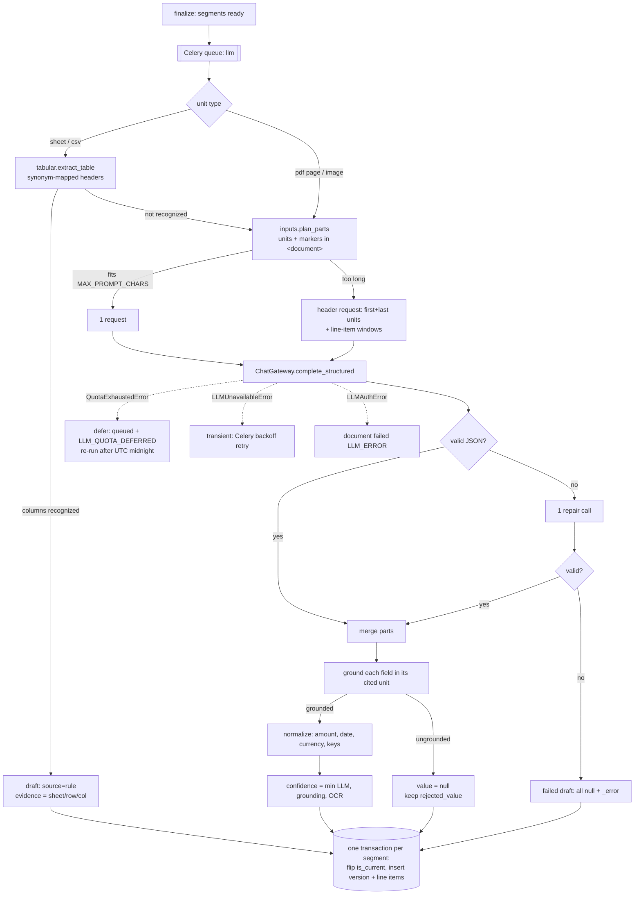

# AI extraction layer

Turns parsed units (Step 3) into versioned `extractions` with per-field evidence, while **never inventing a value**.
An unreliable free-tier LLM is assumed: every request is budgeted, retried deliberately, and cached.

| Package | Responsibility | I/O |
|---|---|---|
| `app/llm/` | Gateway: chat + embeddings, fallback, retries, circuit breaker, rate limit, quota, cache | HTTP (transport), Redis |
| `app/extraction/schemas.py` | What the model must return (raw strings + evidence) | — |
| `app/extraction/prompts/` | Versioned prompt files | files |
| `app/extraction/inputs.py` | Segment → prompt parts; split/merge oversized segments | — |
| `app/extraction/normalize.py` | Raw strings → Decimal / date / ISO 4217 / match keys | — |
| `app/extraction/grounding.py` | Evidence must exist in the cited unit | — |
| `app/extraction/confidence.py` | Confidence fusion | — |
| `app/extraction/assemble.py` | LLM answer → grounded, normalized, scored draft | — |
| `app/extraction/tabular.py` | Spreadsheets without the LLM | — |
| `app/extraction/service.py`, `repository.py` | Orchestrate one document; persist versions | DB |
| `app/pipeline/extract_stage.py` | Map LLM outcomes onto pipeline semantics | — |

Business logic is pure. Network, Redis and DB access sit at the edges (transport, repositories, tasks), and every dependency is injected (gateway, cache, rate limiter, clock).

## Flow

## Gateway design (`app/llm/`)

All network traffic goes through `OpenRouterTransport`, the only module that imports the openai SDK. Everything leaving it is a provider-neutral type, and every failure is a classified `ProviderError`.

**Model fallback** happens in our code, not OpenRouter's routing, so retries, circuit breaking and logs stay under our control. Chat models are tried in the order `LLM_PRIMARY_MODEL` then `LLM_FALLBACK_MODELS`, and the model that actually answered is recorded (`extractions.model_name`).

**Capabilities come from the catalog, never from trial and error.** `GET /models` is public and costs no quota; it is cached in Redis for 24 h. It tells us:
- **Structured-output mode.** The free `nemotron-3-ultra` endpoint advertises `reasoning` and `tools`, but *not* `response_format` or `structured_outputs`. So the gateway starts in prompt mode (schema embedded in the system prompt) instead of burning a request on a 400. Models that do support it get strict `json_schema` with `provider.require_parameters=true`, so OpenRouter can't route them to a provider that silently drops the schema. A 400 still steps down `json_schema → json_object → prompt`.
- **Reasoning effort.** The requested effort (`LLM_REASONING_EFFORT=low`) is mapped to the nearest supported one: the free Nemotron model only offers `high`, `medium` and `none`, so `low` becomes `medium`. Reasoning text is excluded from the response (`reasoning.exclude=true`). `<think>` blocks and code fences are still stripped defensively before parsing.

**Validation.** Every response is validated with Pydantic in every mode. A failure gets exactly one repair call (same conversation, plus the validation errors), and then `ExtractionParseError`.

**Retry policy** (per model, `RequestExecutor`):

| Response | Action |
|---|---|
| 429 (per-minute) | Wait `Retry-After` or `X-RateLimit-Reset`, then retry. A wait over `LLM_MAX_RETRY_AFTER_S` goes to the next model instead. |
| 429 (daily cap) | Mark the day spent, raise `QuotaExhaustedError`. |
| 5xx, timeout, connection | Full-jitter exponential backoff, at most 3 attempts, then the next model. |
| 400 | No retry, except the output-mode step-down. |
| 401 / 402 / 403 | `LLMAuthError`: permanent. |

**Circuit breaker** (Redis, shared by all workers). After `CIRCUIT_FAILURE_THRESHOLD` consecutive failures a model is skipped for `CIRCUIT_OPEN_S`. The next call after that is a trial: success closes the breaker, failure re-opens it. The deadline is a clock timestamp rather than a Redis TTL, so tests drive it with a fake clock.

**Rate limit and quota** (Redis, shared by all workers; every `:free` model, embeddings included, draws from one budget):
- **Per minute.** A sliding window allows `FREE_MODEL_RPM=18` requests, leaving headroom under OpenRouter's 20. Callers block, through the injected clock, until a slot frees up.
- **Per day.** A counter keyed by UTC date enforces `FREE_MODEL_DAILY_LIMIT`. It is **reserved before sending**, so an exhausted budget raises `QuotaExhaustedError` without spending a request; failed requests count too, as OpenRouter counts them. Every `QUOTA_RESYNC_S` it is resynced from `GET /key → free_model_daily_requests`, which doesn't cost quota, without ever lowering what we've already counted.

**Response cache.** The key is `sha256(purpose, model chain, prompt_version, messages + schema)`, with TTL `LLM_CACHE_TTL_S`. Re-processing identical content costs no quota unless `force=True` (`python -m app.cli extract <id> --force`).

**Timeouts.** Connect 10 s; read `LLM_READ_TIMEOUT_S=240`, because reasoning models are slow. `LLM_MAX_TOKENS` is generous: reasoning shares the output budget, and with `exclude=true` an exhausted budget shows up only as empty content, which then goes through validation and repair.

**Quota deferral** (orchestrator). A `QuotaExhaustedError` puts the document in `queued` with `error_code=LLM_QUOTA_DEFERRED`; it is never marked failed. The Celery task re-schedules itself (as a new task, so no retry budget is spent) at the next UTC midnight plus up to `LLM_DEFER_JITTER_S`. Because that eta is about 24 h out and tasks use `acks_late`, the Redis `visibility_timeout` is raised to 25 h. Otherwise Redis would redeliver the scheduled task every hour. The trade-off: an unacked task on a *crashed host* waits up to 25 h. A crashed worker *process* is still requeued immediately (`task_reject_on_worker_lost`).

**Queue isolation.** LLM work runs on its own Celery queue, `llm`, so rate-limit waits never block OCR workers.

## Embedding spaces

`EmbeddingGateway.embed(texts, input_type="query"|"document")`:
- **Batching.** One request per `EMBED_BATCH_SIZE` inputs, since every request costs daily quota.
- **Input limit.** Each input is capped at the model's context (`context_length × EMBED_CHARS_PER_TOKEN`, a conservative estimate). Truncations are counted.
- **Dimension.** It requests `dimensions=1024` and, whatever comes back, truncates to the first 1024 values (Matryoshka-style) and L2-normalizes, so `‖v‖ = 1`. A model whose native dimension is below 1024 fails fast (`EmbeddingDimensionError`): padding would distort similarity.
- **Input type.** It passes OpenRouter's `input_type` (`search_query` / `search_document`).

**Vectors from different spaces are never compared.** A space is a set of vectors that are directly comparable, which in practice means one model (same weights). Two different models are two spaces even at the same dimension, because their coordinates mean different things: cosine similarity between them is noise. Every `EmbeddingResult` therefore carries:
- `space`: the label from `EMBEDDING_MODELS` config
- `is_primary_space`
- `model_used`

How fallback treats spaces:
- **Within a space** it is transparent, and batches already embedded are reused.
- **Across spaces** the *whole call* is re-embedded with the fallback model, and the result is tagged with the new space.

Step 7 stores `chunks.embedding_space` and must search per space (and re-embed fallback-space chunks later).

The default config gives each Nemotron model **its own** space. The spec grouped `nemotron-3-embed-1b` and `nemotron-3.5-embed-1b` under one label, but they are different models: one text-only, one multimodal. Only group models whose weights you know are identical.

## Anti-hallucination design

1. **Verbatim raw values.** The model returns strings copied exactly from the document (`raw_value`) plus `evidence`: an exact substring of at most 200 characters, and the `unit_index` it came from. It is told never to convert, compute, infer or "fix" anything. All typing happens in code.
2. **Null policy.** Missing, illegible or uncertain means `null` (confidence 0). The prompt forbids deriving values: no tax from total − subtotal, no total from line amounts. Inconsistent printed numbers are extracted as printed. The smoke test proves this with a deliberately wrong total.
3. **Grounding** (`grounding.py`). For every non-null field:
   - the evidence must match the *cited* unit's text: case- and whitespace-insensitive, exact or a rapidfuzz `partial_ratio ≥ GROUNDING_MIN_SCORE` (0.85) to tolerate OCR noise;
   - the raw value must occur inside the evidence;
   - only units of the segment being extracted count, so evidence cited from another segment fails.

   An ungrounded value becomes `null`, and field_meta keeps `{rejected_value, reason: "ungrounded", grounding_failure, grounding_score}` so Step 5 can raise `UNGROUNDED_VALUE`. Nothing is dropped silently.
4. **Confidence fusion** (`confidence.py`). A field's confidence is `min(LLM confidence, grounding score, OCR confidence of the cited unit)`, multiplied by `AMBIGUOUS_PARSE_CONFIDENCE_FACTOR` when normalization had to choose, for example between `1,234` as 1234 and 1.234. LLM self-confidence alone is poorly calibrated. `overall_confidence` is a weighted mean over the required fields (`FIELD_WEIGHTS`), with a missing field counting as 0.
5. **Prompt-injection defense.** Document text is untrusted. It sits between `<document>` and `</document>`, and any `<document>` or `</document>` tags inside it are neutralized (`[document]`), so the text can't close the block. The system prompt says to ignore any instructions found inside. A test plants an injection and checks that it stays inside the block.

## Prompt versioning

Prompts are files, never strings in Python. For version `invoice_extraction_v1` there is one system prompt, one user template and three scopes:
- `invoice_extraction_v1.system.md`
- `invoice_extraction_v1.user.md`
- `invoice_extraction_v1.scope.{full,header,line_items}.md`

`PROMPT_VERSION` is stored on every extraction (`extractions.prompt_version`) and is part of the cache key. Changing any wording means a new version: copy the files to `_v2`. Stored extractions always say which instructions produced them, and the cache never serves an answer produced by older instructions.

`tests/extraction/golden/invoice_extraction_v1.full.txt` pins the rendered prompt. Regenerate it deliberately with `UPDATE_GOLDEN=1 pytest tests/extraction/test_prompts_inputs.py`.

Rule-based extractions store `prompt_version = model_name suffix = tabular_v1`.

**Oversized segments** (rendered text > `MAX_PROMPT_CHARS`):
1. One HEADER request with the first and last units, where header fields and totals live.
2. LINE_ITEMS requests over consecutive windows of units.
3. Header fields come from (1); line items are concatenated from (2) and de-duplicated on description, quantity and amount.

## Normalization rules (`normalize.py`, pure, table-tested)

- **Amounts → `Decimal`, 4 dp.**
  - Formats: `1,234.56`, `1.234,56`, `1 234,56` (including narrow no-break spaces), `1'234.50`, Indian `1,23,456.00`, `(123.45)`, `-123.45`, `123.45-`, the Unicode minus sign, and attached symbols or codes.
  - **When both separators appear,** the last one is the decimal separator.
  - **When only one appears,** a repeated separator is a thousands separator; a single one with 1–2 or 4+ trailing digits is the decimal separator.
  - **Ambiguous `1,234`** is resolved from document evidence: the extracted amounts plus every amount printed in the segment. Without evidence it is read by the commonest convention, flagged `ambiguous` (confidence lowered) and noted in `uncertainties`.
  - Anything beyond NUMERIC(18,4) is refused.
- **Dates → ISO.**
  - ISO and month-name forms are unambiguous.
  - DD/MM vs MM/DD is settled by the value itself (a component > 12) or by document-level evidence: any other date printed in the segment with a component > 12, or a month-name date's order.
  - With no evidence an ambiguous date is **refused** (`null` + note): an invoice date off by months is worse than none.
  - Impossible dates (`31/02`, `29 Feb 2023`) are refused.
- **Currency → ISO 4217.**
  1. An explicit code wins, from the currency field or an amount.
  2. Prefixed symbols (`US$`, `C$`, `A$`, `HK$`, `R$`, `RMB`) and unambiguous symbols (`€ £ ₹ ৳ ₩ ₦ ₱ ₫ ₪ ₺ ₴ ₽ ฿`) map directly.
  3. `$`, `¥` and `kr` resolve only when exactly one of their candidate codes appears in the document text; otherwise `null` + note. **USD is never a default.**
  4. If no currency field is printed but a grounded amount carries a symbol or code, the currency is taken from that amount (`derived_from: amount_symbol`).
- **Match keys** (Step 2 duplicate detection):
  - `supplier_name_norm`: NFKC + casefold, punctuation removed, trailing legal suffixes removed (Ltd, LLC, Inc, GmbH, Pvt, …), whitespace collapsed.
  - `invoice_number_norm`: NFKC, uppercase, alphanumerics only.

## Spreadsheets cost zero LLM requests

`tabular.py` runs before the LLM for sheet and CSV units:
1. Headers are mapped through a synonym table: invoice no / inv # / bill no; vendor / supplier / seller; client / customer / buyer; qty; rate / unit price; amount / line total; vat / gst / tax; subtotal / net; total / gross / grand total; currency / ccy.
2. If an invoice-number column and a total or amount column map, rows are grouped by invoice number. Rows without a number continue the previous invoice, so line-level sheets work.
3. That gives one extraction per invoice, `source="rule"`, with evidence like `sheet March row 4 col Total`.
4. Conflicting values for one invoice (two different totals) become `null` + `conflicting_rows`.
5. In a workbook where at least one sheet is a recognized invoice table, the other sheets (lookups, rates, summaries, hidden helper sheets) are **supporting data**: they are skipped with an `auxiliary_sheet` event, not sent to the LLM. Only a workbook with no recognized sheet falls back to the LLM, using each sheet's text rendering. (Found by the live run: without this rule the Step 3 fixtures spent 3 requests on lookup and summary sheets.)

## Persistence and idempotency

- **One transaction per segment** goes through Step 2's `add_extraction_version`: it locks the document row, flips the previous `is_current`, and inserts the new version with `field_meta`, `raw_llm_response` (per request part: scope, units, output mode, repaired, cached, validated response), `token_usage`, `latency_ms`, the actual `model_name`, `prompt_version` and `processing_job_id`. Line items are inserted in the same transaction. `review_status` stays `pending`; Step 5 decides it.
- **A Celery retry of the same job never creates an extra version.** Invoice indexes this job already saved are skipped *before* any LLM call, so retries spend no quota. `save()` re-checks under the document lock.
- **Partial failure.** A segment that fails validation is persisted with all-null fields and `field_meta._error`; the other segments are unaffected.
- **`document_type: other`** doesn't force invoice fields. It records `NOT_AN_INVOICE` in `field_meta._uncertainties` and the segment event.
- **Events.** `processing_events` (stage `extract`) has one row per segment (duration, model, token usage, requests, cache hits, status) plus a document summary.

## Data privacy on free endpoints

Free (`:free`) NVIDIA endpoints on OpenRouter may log prompts and completions, and providers can use them. **This project uses synthetic or public documents only.** Real invoices contain personal and commercial data, and must not be sent to free endpoints.

For real data: use a paid endpoint with a no-logging policy, set OpenRouter's data policy to deny training and logging providers, or self-host the model.

Logs carry metadata only (model, purpose, attempt, outcome, latency, tokens). Prompts and document text are never logged at INFO. The SDK's own loggers (`openai`, `httpx`, `httpcore`) are pinned to WARNING at the transport edge, because at DEBUG the openai SDK logs full request bodies. A test enforces this.

## Secrets

`OPENROUTER_API_KEY` is read from the environment only (`SecretStr`). It is never hard-coded, logged or returned; `.env` is gitignored, and `.env.example` holds a placeholder.

Pre-commit runs `detect-secrets` (against an audited `.secrets.baseline`) plus a pattern hook for the OpenRouter key shape. detect-secrets alone misses a key that isn't assigned to a secret-looking variable name.

## Testing

`pytest tests/llm tests/extraction` makes **zero network calls**:
- Sockets are blocked with pytest-socket; the extraction tests allow only the test DB host.
- HTTP is mocked with respx, Redis with fakeredis, and time with a fake clock.

`openai` is pinned to 2.x because 3.x moved to `httpx2`, which respx cannot intercept. The SDK is confined to `transport.py`, so upgrading is a single-module change once respx supports httpx2.

Live tests (`@pytest.mark.live`) run only with `RUN_LIVE_LLM=1`. `scripts/smoke_extraction.py` runs 3 synthetic invoices end to end in ≤ 6 requests.

## Known limitations

- **Free tier.** 50 requests/day (1,000 with credits) is roughly 25–50 invoices a day once repairs and oversized segments are counted. That's fine for evaluation, not for production volume.
- **Accuracy limits.** Grounding proves the evidence exists, not that the model chose the *right* evidence. A real value can still be attached to the wrong field (a PO number as the invoice number) if both are printed. Step 5's cross-field rules are the next line of defense.
- **Fuzzy grounding.** It tolerates light OCR noise; heavily garbled scans have values rejected as ungrounded (safe, but more nulls).
- **Header/window splitting.** For very long invoices it assumes header fields are on the first or last page.
- **Tabular extractor scope.** It only recognizes English header synonyms, and it doesn't split one sheet into invoices by layout, only by invoice-number column.
- **Bounding boxes.** Evidence is matched against unit text, not boxes. The Step 3 line boxes can locate it for UI highlighting later.
