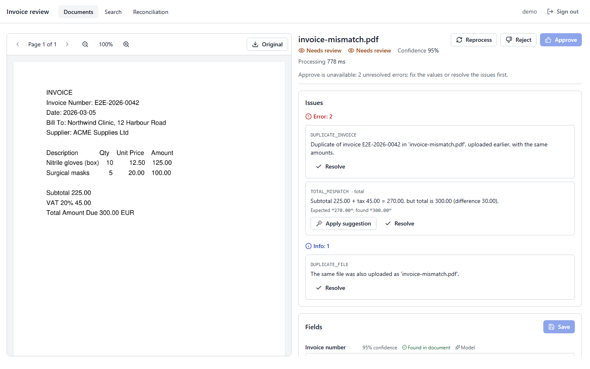

# Review UI (frontend)

A Next.js (App Router, TypeScript strict) app for uploading invoices, reviewing
extractions, searching and reconciling. It sits behind a login and talks to the
backend only through its own server (a backend-for-frontend), so **the browser
never sees the API key**.



## Architecture

```
browser ──(session cookie)──► Next.js server ──(Bearer API key)──► FastAPI /api/v1
           /api/auth/*           /api/proxy/[...path]
```

- **Login**: `POST /api/auth/login` checks `DEMO_USERNAME` / `DEMO_PASSWORD_HASH`
  (bcrypt; a dummy hash is checked for unknown users so timing does not leak
  them), throttled to 10 attempts/min per client, and sets an iron-session cookie
  (`cg_session`: httpOnly, SameSite=Lax, Secure in production, 8 h).
- **Guard**: `src/proxy.ts` (Next 16's middleware) redirects every page except
  `/login` to `/login?next=…` and answers `/api/*` with 401 without a session. It
  also sets a per-request CSP nonce (`script-src 'nonce-…' 'strict-dynamic'`).
- **Proxy**: `src/lib/server/proxy-handler.ts` forwards only an allowlist of
  paths and methods (`proxy-rules.ts`), only selected request and response
  headers, rejects `..`/`//`, requires a same-origin `Origin` on mutations
  (CSRF), adds `Authorization: Bearer $API_KEY` and `X-Request-ID`, and streams
  bodies both ways.
- **Secrets** are server-only (`src/lib/server/env.ts`, `server-only` import,
  zod-validated). No `NEXT_PUBLIC_*` variables exist; ESLint bans them, and
  `npm run check:bundle` scans the built client chunks for the secret values.
- **API client**: types generated from `docs/openapi.json` (`npm run gen:api`,
  `npm run check:api` fails if stale); `openapi-fetch` with a middleware that
  maps problem+json errors to `AppError` (user message, field errors, request
  id). Conditional GETs reuse ETags; processing documents are polled with
  backoff from 1 s to 5 s.
- **Money and dates**: amounts stay decimal strings end to end (formatting via
  `Intl.NumberFormat` with string input, arithmetic via BigInt); ISO timestamps
  are shown in the user's locale with the exact value in a tooltip.
- **Security headers** (`next.config.ts`): nosniff, `X-Frame-Options: DENY`,
  `Referrer-Policy: no-referrer`, Permissions-Policy, COOP; no `X-Powered-By`;
  no `dangerouslySetInnerHTML` (ESLint `react/no-danger`).

## Screens

| Screen | What it does |
| --- | --- |
| Documents | URL-synced filters, cursor pagination, upload dialog (drag and drop, per-file progress, one Idempotency-Key per batch, live status), "Start reviewing" opens the next document needing review. |
| Review | Page viewer (thumbnails, zoom) or sheet table for spreadsheets; header fields with confidence, evidence and "show on page"; line items with arithmetic hints; issues with apply suggestion / resolve / reopen; save sends only changed fields with `If-Match` (412 opens a conflict dialog, 422 errors show inline); approve / reject / reprocess; versions, corrections and timeline tabs; invoice switcher for multi-invoice files; unsaved-changes guard. |
| Search | Keyword, semantic and hybrid modes, debounced (keyword 300 ms; others 600 ms from 3 characters), highlighted snippets, a banner when semantic search degraded to keyword. |
| Reconciliation | Pick invoices, start a run, poll the report. |

Keyboard: `Ctrl/Cmd+S` save, `J`/`K` next/previous issue, `A` approve,
`N` next document, `?` help, `[`/`]` pages. Letter shortcuts are ignored while
typing or when a dialog is open.

## Setup

1. Create a reviewer API key for the UI and put it in the repo's `.env`:

   ```sh
   docker compose exec api python -m app.cli api-key create --name review-ui --role reviewer
   ```

2. Fill the rest of the "review UI" section of `.env` (see `.env.example`):

   ```sh
   # session secret (32+ chars)
   python -c "import secrets; print(secrets.token_urlsafe(32))"
   # bcrypt hash of the demo password (read from stdin)
   cd frontend && npm run hash-password
   ```

   Compose interpolates `$`, so write the hash with every `$` doubled (`$$2b$$12$$…`);
   the script prints that form as a hint.

3. `docker compose up -d --build` serves the UI on http://localhost:3000.

## Development

```sh
cd frontend
npm ci
BACKEND_URL=http://localhost:8000 API_KEY=… SESSION_SECRET=… \
DEMO_USERNAME=demo DEMO_PASSWORD_HASH='$2b$12$…' npm run dev
```

| Command | Purpose |
| --- | --- |
| `npm run lint` | ESLint (type-checked rules, zero warnings) |
| `npm run typecheck` | `tsc --noEmit` |
| `npm test` | Vitest + Testing Library + MSW (unit and component tests) |
| `npm run test:e2e` | Playwright against the running compose stack (uses `E2E_USERNAME` / `E2E_PASSWORD` from `.env`; runs axe and writes the screenshots in `docs/images/`) |
| `npm run gen:api` / `check:api` | Regenerate / verify the OpenAPI types |
| `npm run build` && `npm run check:bundle` | Production build, then assert no secret is in the client bundle (`API_KEY=… SESSION_SECRET=… npm run check:bundle`) |

The e2e fixtures are synthetic: `python scripts/make_e2e_fixtures.py` rebuilds
them (the invoice's printed total is deliberately wrong, so validation raises
`TOTAL_MISMATCH` and the test corrects it by keyboard alone).

## Known limitations

- All backend audit fields record the shared `review-ui` API key, not the
  logged-in user; per-user identity needs per-user keys or a signed
  on-behalf-of header in the backend.
- The login throttle and ETag cache are per process (in memory); use Redis for
  more than one frontend replica.
- One demo account from env; real deployments need an identity provider.
