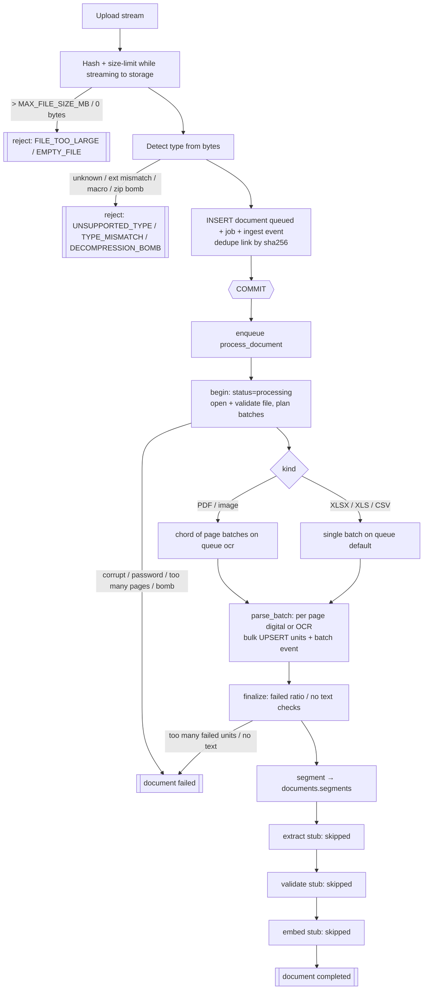
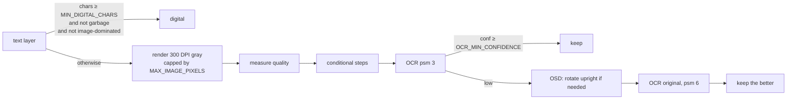

# Ingestion & parsing pipeline

Turns an uploaded file into `document_units` (one per PDF page, image frame, sheet or CSV) plus invoice
boundaries (`documents.segments`), with a complete `processing_events` history. Every input is treated
as hostile: the worker must never crash, memory must stay flat on 1,000-page files, and every failure
ends in a precise error code.

| Module (`backend/app/pipeline/`) | Responsibility | Touches DB? |
|---|---|---|
| `errors.py` | Permanent vs transient error taxonomy | no |
| `storage.py` | `Storage` protocol, `LocalStorage` (UUID keys) | no |
| `filetypes.py` | Real type from bytes; zip-bomb / macro checks | no |
| `intake.py` | Stream → store + hash → detect → register → enqueue | **yes** |
| `text_utils.py` | NFKC, NUL stripping, whitespace, truncation | no |
| `pdf.py` | PyMuPDF: digital vs OCR per page, layout lines | no |
| `images.py` | Pillow: bomb guard, EXIF, frames, 8-bit gray | no |
| `preprocess.py` | Quality metrics + conditional OpenCV steps | no |
| `ocr/` | `OcrEngine` protocol, Tesseract engine, fallback runner | no |
| `spreadsheet.py`, `csv_parser.py`, `tables.py` | XLSX/XLS/CSV → raw-string tables | no |
| `segment.py` | `Segmenter` protocol + heuristic boundaries | no |
| `orchestrator.py` | Stages, status, events, idempotent upserts | **yes** |
| `app/workers/` | Celery app + thin task wrappers | via orchestrator |
| `app/cli.py` | `python -m app.cli ingest <path> [--sync]` | via orchestrator |

Parsers are pure (path in, dataclasses out), so they are tested without a database.

## Flow

Per PDF page:

## Library choices

- **PyMuPDF (MuPDF)** for PDFs. It is the fastest Python PDF engine for both text extraction and
  rasterization; the benchmark measured about 1,500 digital pages per second on one core. It gives reading-order text with
  line bounding boxes in one call, renders straight to grayscale (no RGB→gray copy), repairs damaged
  xref tables and reports what it repaired, and never runs PDF JavaScript. pdfminer and pdfplumber are
  10–50× slower; pdf2image shells out to poppler.
- **Tesseract 5 (LSTM) via pytesseract** for OCR, not PaddleOCR. It is CPU-only, a ~30 MB install with
  apt-packaged language packs, deterministic, and its word confidences and boxes are good enough for
  evidence highlighting. PaddleOCR is more accurate on hard scans and dense tables but pulls in
  PaddlePaddle (hundreds of MB), is fastest on GPU, and its CPU throughput per core is lower. The
  `OcrEngine` protocol keeps that door open: a `PaddleEngine` can be added and routed to (for example, a
  low-confidence retry tier) without touching any parser.
- **OpenCV (headless)** for image metrics and preprocessing: Laplacian, connected components,
  warpAffine and adaptive thresholds are C++-fast. The headless wheel needs no libGL in the image.
- **openpyxl (read-only) / xlrd** for spreadsheets. Both read cached values only, so formulas and macros
  are never evaluated. pandas is deliberately not used: it would coerce `00123` to `123` and `1.234,56`
  to a float or NaN.
- **charset-normalizer** to guess CSV encodings when there is no BOM and the data isn't valid UTF-8.
- **defusedxml** stops XML entity-expansion ("billion laughs") attacks in the sheet XML we stream.
  openpyxl also switches to it automatically when it is installed.

## Thresholds and how they were chosen

All are `PipelineSettings` fields (`app/config.py`), overridable via environment variables of the same
name.

| Setting | Default | Rationale |
|---|---|---|
| `MAX_FILE_SIZE_MB` | 100 | Largest realistic invoice batch; a 1,000-page scanned PDF at 200 DPI JPEG is about 80 MB. |
| `MAX_PAGES` | 2000 | 2× the stated maximum; checked right after open, before any work. |
| `PAGE_BATCH_SIZE` | 25 | 25 OCR pages ≈ 1.5 min per task: long enough to amortize the file open, short enough for good chord parallelism and a cheap retry. |
| `OCR_DPI` | 300 | Tesseract's accuracy plateaus at about 300 DPI; 200 loses small print. |
| `MIN_DIGITAL_CHARS` | 50 | Below this a page is a scan with a stray header or a stamp, not a text page. |
| `SPARSE_TEXT_CHARS` / `IMAGE_COVERAGE_OCR_RATIO` | 200 / 0.5 | Scans with a thin digital overlay (a scanner stamp, a filename) must still be OCRed. |
| `GARBAGE_MIN_ALNUM_RATIO` / `GARBAGE_MAX_REPLACEMENT_RATIO` | 0.5 / 0.02 | Real invoice text is over 70% alphanumeric; broken ToUnicode maps produce symbol soup, U+FFFD, or `(cid:N)`. |
| `OCR_ORIENTATION_MODE` | `on_low_confidence` | OSD costs about 1 s per page (about 25% of a page's time) and almost every scan is upright. Tesseract's psm 3 already reads sideways text; upside-down text scores very low, which triggers OSD for attempt 2. `always` runs OSD up front; `never` disables it. |
| `OCR_MIN_CONFIDENCE` | 0.6 | Clean synthetic and real scans score 0.90–0.96; under 0.6 the second attempt often wins. |
| `MIN_EFFECTIVE_DPI` / `MIN_TEXT_HEIGHT_PX` | 200 / 20 | Tesseract recommends cap height ≥ 20 px; upscaling is capped at `MAX_UPSCALE_FACTOR` (3×) and by the pixel limit. |
| `DESKEW_MIN_ANGLE_DEG` | 0.5 | Below 0.5° Tesseract copes, and rotating would only resample (blur) the image. |
| `NOISE_SPECK_RATIO` | 0.3 | Share of connected components that are ≤ 4 px specks. Clean pages are under 0.1; salt-and-pepper scans are over 0.5. |
| `LOW_CONTRAST_THRESHOLD` | 100 | Paper-to-ink brightness gap. Crisp print is about 200; faded thermal receipts fall below 100. |
| `UNEVEN_ILLUMINATION_THRESHOLD` | 25 | Std of the heavily blurred background; phone photos with shadows exceed this, so adaptive thresholding is used instead of Otsu. |
| `MAX_FAILED_UNIT_RATIO` | 0.2 | One bad page in five still yields usable invoices; worse than that, a human should look at the file. |
| `MAX_ZIP_UNCOMPRESSED_MB` / `MAX_ZIP_RATIO` | 1024 / 200 | Real XLSX files compress 5–30×; a zip bomb's ratio is in the thousands. The ratio is only checked for members ≥ 1 MB. |

The heuristic values were set on the synthetic fixtures plus common sense about real scans. They are
starting points: the evaluation report (`eval/`) should re-tune them on labeled real documents. Every
decision is recorded (`image_quality.preprocess_steps`, `ocr_attempts`, `classification`), so you can see
why a page took a path.

## Error codes

| Code | Family | Where | Meaning |
|---|---|---|---|
| `EMPTY_FILE` | permanent | intake (reject) | 0 bytes |
| `FILE_TOO_LARGE` | permanent | intake (reject) | exceeded the limit while streaming; the rest is never read |
| `UNSUPPORTED_TYPE` | permanent | intake (reject) | unknown content, macro-enabled or binary Office |
| `TYPE_MISMATCH` | permanent | intake (reject) | the extension claims a type the content isn't (an .exe renamed .pdf) |
| `DECOMPRESSION_BOMB` | permanent | intake (zip) / worker (image) | unsafe expansion ratio or pixel count |
| `CORRUPT_FILE` | permanent | worker | unopenable, 0 pages, or repaired with no usable text |
| `PASSWORD_PROTECTED` | permanent | intake (encrypted zip/OOXML) / worker | needs a password (an empty user password is tried) |
| `TOO_MANY_PAGES` | permanent | worker | more than `MAX_PAGES` pages or frames |
| `NO_TEXT_FOUND` | permanent | worker | every unit is empty |
| `OCR_ERROR` | unit | worker | Tesseract failed on that page; the job continues |
| `TIMEOUT` | transient → unit | worker | page OCR exceeded `OCR_PAGE_TIMEOUT_S` twice, or the task hit its soft time limit |
| `STORAGE_ERROR` | transient | intake / worker | blob store unavailable; retried with backoff |
| `INTERNAL_ERROR` | — | worker | a bug; the document is failed by `on_failure`, and the worker keeps running |

Intake rejections leave nothing behind (no blob, no row), so the API can answer 4xx synchronously.
Errors carry a user-safe `message` (`documents.error_message`) and internal `details` (in the failed
`processing_events` row and the logs).

## Partial failure and idempotency

- **One bad page doesn't fail the document.** It becomes a unit with `error_code` and a `UNIT_FAILED`
  warning. The document fails only if `failed / total > MAX_FAILED_UNIT_RATIO` (using the most common unit
  code) or no unit has text (`NO_TEXT_FOUND`, or `CORRUPT_FILE` when MuPDF had to repair the file).
- **Re-running never duplicates.** Units are bulk-upserted on `(document_id, unit_type, unit_index)`, so
  unit ids stay stable. Each run is a new `processing_jobs` row with its own events.
- **`fail()` is idempotent per job.** The chord errback and a task's `on_failure` may both report the same
  failure; only one event is written.

## Celery

- `acks_late` + `task_reject_on_worker_lost`: a killed worker's task is redelivered.
- `worker_prefetch_multiplier=1`, plus soft (900 s) and hard (960 s) time limits per task.
- `worker_max_tasks_per_child=100` recycles processes, which caps slow leaks in native libraries.
- Queues: `ocr` (PDF and image batches, CPU-bound; size the pool to your cores) and `default`
  (orchestration, spreadsheets, finalize).
- Only `TransientError` and SQLAlchemy `OperationalError` autoretry: exponential backoff, jitter,
  at most 3 retries.
- `OMP_THREAD_LIMIT=1` is set in the image: parallelism comes from worker processes, and Tesseract's
  OpenMP threads would oversubscribe the CPUs.
- The DB commit happens before enqueue, so a worker never sees a missing row. If Redis is down after the
  commit, the document stays `queued`; a periodic sweeper that requeues stale `queued` jobs is a
  follow-up.

## Memory strategy for large files

- **Intake** streams in 1 MB chunks and never buffers the whole upload.
- **PDFs** are processed one page at a time. The single rendered pixmap is converted to a numpy array and
  freed before the next page, so at most one rendered page exists per process. Text extraction excludes
  embedded image bytes (no `TEXT_PRESERVE_IMAGES`).
- **Render size** is capped: DPI is lowered so that `w × h ≤ MAX_IMAGE_PIXELS` (a 200-inch page can't
  allocate gigabytes).
- **Batches**: each Celery task reopens the file and parses its 25 pages, then units are bulk-written and
  dropped. Memory is O(batch), not O(document); see the benchmark for the measured peak RSS.
- **Images**: frames are decoded one at a time with `seek()`.
- **Spreadsheets**: openpyxl runs in read-only streaming mode, the sheet XML scan clears elements as it
  goes, and rows stop at `MAX_SHEET_ROWS`.

## Security measures (untrusted input)

- The user's filename is never used in a path. Storage keys are `ab/cd/<uuid4>`, validated by regex, and
  writes are atomic (temp file + rename).
- Type comes from magic bytes, never from the extension or the client's MIME type.
- Size is enforced while streaming; the zip-bomb check (total and per-member ratio, entry count) runs
  before any XML is parsed.
- Macro-enabled (`xlsm`, `vbaProject.bin`, `_VBA_PROJECT_CUR`) and binary (`xlsb`) workbooks are
  rejected; formulas are never evaluated.
- XML is parsed through defusedxml (billion laughs, external entities).
- Image decompression bombs are caught from the header, per frame, and between 1× and 2× the limit
  (Pillow's own guard only raises above 2×).
- Subprocesses (Tesseract) run without `shell=True`, with per-page timeouts. Every task has hard time
  limits, and the worker runs as a non-root user.
- NUL and control characters are stripped before any text reaches Postgres.
- Errors shown to users are generic; paths and library messages stay in internal details and logs.

## Data shapes

`document_units.structured_data`:

- **PDF page** — `{lines: [{text, bbox: [x0,y0,x1,y1], confidence?}], coord_space: "pdf_points", page_size, classification}`
- **Image frame** — `{lines, coord_space: "image_pixels", image_size}`. Bboxes are mapped back through
  crop and scale; orientation and deskew are recorded in `image_quality.transform` but not inverted.
- **Sheet / CSV** — `{headers, rows: [{<header>: "raw string", _row, _block}], table_blocks: [{index, start_row, end_row, header_row, headers, n_rows}], primary_block, hidden, n_rows, n_cols, warnings}`,
  plus `merged_ranges` for sheets and `encoding` / `delimiter` for CSV.

`document_units.image_quality` (OCR units): `width, height, dpi, blur_score, contrast,
illumination_unevenness, speck_ratio, skew_deg, text_height_px, preprocess_steps, ocr_variant,
ocr_attempts[], transform`.

`documents.segments`: `[{unit_start, unit_end, confidence, reasons[], invoice_number}]`.

## Hooks for later steps

- **Step 4 (extraction):** implemented. `finalize()` stops after segmentation (`PARSE_TAIL_STAGES`) and `run_llm_stages()` runs extract → validate → embed on the Celery queue `llm`; see docs/extraction.md.
- **Step 5 (validation)** and **Step 7 (embeddings):** replace the stubs in `POST_EXTRACT_STAGES`.
- **Step 6 (API):** call `ingest_file(stream, filename, user, session, storage=…,
  enqueue=enqueue_document)` and map `PermanentError.code` to 413/415/422.

## Known limitations

- Handwriting is not recognized reliably (Tesseract is trained on print).
- Tables inside images lose their structure: OCR yields lines, not cells. Step 4 must rebuild columns
  from bounding boxes.
- Non-English scans need extra `tesseract-ocr-<lang>` packages and `OCR_LANGS=eng+deu`, for example.
  Scripts like Arabic or CJK also need different preprocessing thresholds.
- Numbers stored as numbers in XLSX with a display format (`00123` shown via format `00000`) come out as
  `123`: we read values, not formatted display strings.
- XLS: xlrd exposes only cached formula values, so a missing cache can't be detected (XLSX can).
- CSV encodings with no BOM are a statistical guess (cp1252 vs cp1250 vs latin-1 can be
  indistinguishable on short files); UTF-16 without a BOM is not supported.
- The segmenter is heuristic. Documents with no page counters, titles or invoice numbers become one
  low-confidence segment for Step 4 to split.
