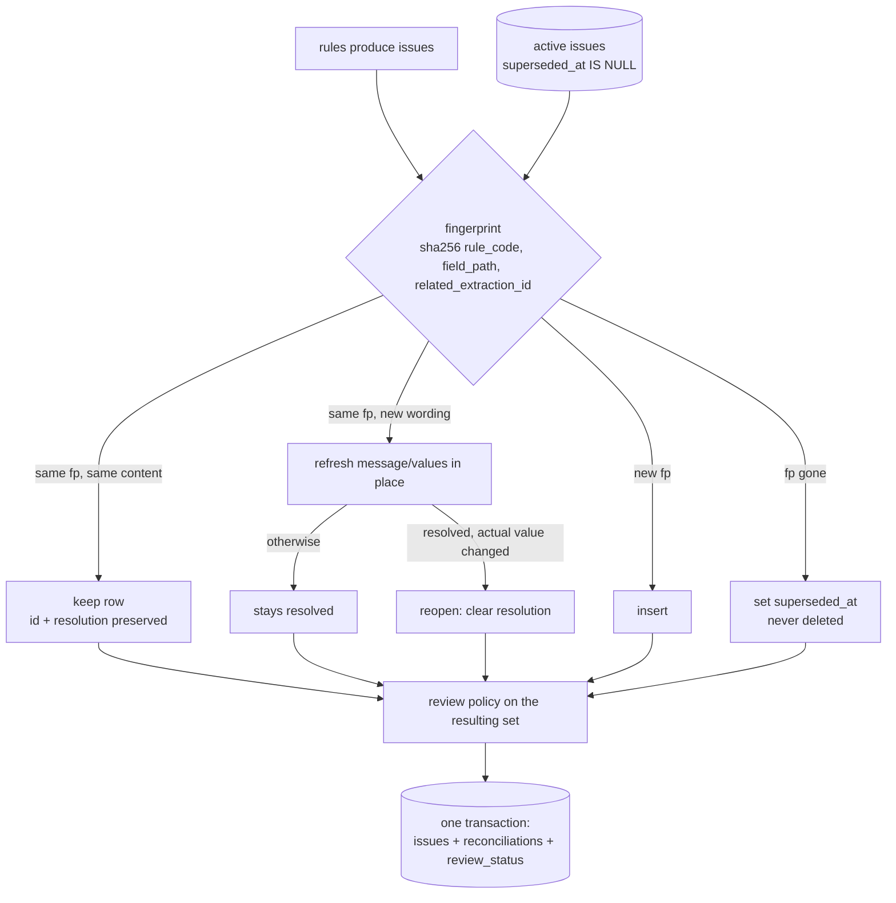

# Validation layer

Validation decides what a human must review, so it aims to be **precise** (few false alarms), **explainable** (every issue says what is wrong and by how much) and **deterministic** (the same extraction always yields the same issues).

| Module (`backend/app/validation/`) | Responsibility | I/O |
|---|---|---|
| `money.py` | ISO minor units, quantize, **the** tolerance rule | — |
| `types.py` | Frozen snapshots, `ValidationContext`, `Issue` | — |
| `rules/` | The rule catalog (pure) and the explicit ordered registry | — |
| `crossdoc.py` | Key-field comparison, duplicate vs cross-doc classification, pg_trgm-compatible similarity | — |
| `policy.py` | Review-decision policy, document status | — |
| `lifecycle.py` | Fingerprint diff (insert / keep / refresh / supersede) | — |
| `repository.py` | Snapshot loading, `CandidateFinder` SQL, issue and reconciliation writes, advisory lock | DB |
| `service.py` | `ValidationService`: one transaction per extraction | DB |
| `reconciliation.py` | Batch matcher (pure) and `ReconciliationService` | DB |

Rules are pure. All I/O happens before them (loading the snapshot and **pre-fetching candidate matches**) and after them (writing issues). A rule sees only a frozen `ValidationContext`: the extraction snapshot, the document info, `today` and the settings.

## Rule catalog

| Code | Severity | Fires when | Example message |
|---|---|---|---|
| `MISSING_FIELD` | per document_type | A required field is null and wasn't rejected | "Invoice number is missing." |
| `UNGROUNDED_VALUE` | error for invoice_number/total, else warning | field_meta has a `rejected_value` with reason `ungrounded`, or rows disagreed (`conflicting_rows`) | "Invoice number 'INV-7777' was rejected: not found in the cited text." |
| `LOW_CONFIDENCE` | warning | Field confidence < `FIELD_CONFIDENCE_MIN`, or overall < `OVERALL_CONFIDENCE_MIN` | "Total has low confidence (0.42 < 0.60)." |
| `NOT_AN_INVOICE` | warning | document_type is `other` | "This does not look like an invoice, receipt or statement." |
| `INVALID_AMOUNT` | error | An amount was printed but can't be parsed | "Total '2,70,0.0' is not a valid amount." |
| `NEGATIVE_AMOUNT` | error | Negative total or subtotal on a non-credit-note | "Total -270.00 is negative on a invoice (only credit notes may be negative)." |
| `SIGN_INCONSISTENT` | warning | Credit note mixes signs across subtotal, tax and total | "Credit note mixes positive and negative amounts: subtotal -40.00, tax 8.00, …" |
| `IMPLAUSIBLE_TAX_RATE` | warning | tax / subtotal < 0 or > `MAX_TAX_RATE` | "Tax 80.00 is 80.0% of subtotal 100.00, outside 0%-50%." |
| `ZERO_TOTAL` | warning | total == 0 | "Total is zero." |
| `LINE_AMOUNT_MISMATCH` | warning | qty × unit price ≠ amount on a line (`line_items[i].amount`) | "Line 2: 5 x 20.00 = 100.00, but the amount is 110.00 (difference 10.00)." |
| `LINE_SUM_MISMATCH` | error | Σ line amounts ≠ subtotal; without a subtotal, compared with total − tax | "Line amounts sum to 205.00 over 2 lines, but subtotal 225.00 (difference 20.00)." |
| `TAX_INCLUSIVE_LINES` | info | Instead of `LINE_SUM_MISMATCH` when Σ lines ≈ total **and** subtotal + tax ≈ total | "Line amounts include tax: they sum to the total 270.00, and subtotal + tax matches it." |
| `TOTAL_MISMATCH` | error | subtotal + tax ≠ total | "Subtotal 100.00 + tax 15.00 = 115.00, but total is 120.00 (difference 5.00)." |
| `INVALID_DATE` | error | A date was printed but couldn't be read (impossible, or ambiguous DD/MM) | "Invoice date '31/02/2024' could not be read (impossible date)." |
| `FUTURE_DATE` | error | invoice_date > today + `FUTURE_DATE_GRACE_DAYS` | "Invoice date 2024-12-01 is in the future (today 2024-04-01, grace 7 days)." |
| `DATE_TOO_OLD` | warning | Older than `MAX_INVOICE_AGE_YEARS` | "Invoice date 2018-01-02 is more than 5 years old." |
| `UNKNOWN_CURRENCY` | error | Not ISO 4217, or an unresolved symbol (`$` with no code printed) | "Currency 'XYZ' is not an ISO 4217 code." |
| `INVOICE_NUMBER_FORMAT` | warning | Normalized key shorter than 2 or longer than 40 characters, or no letters/digits | "Invoice number '7' normalizes to 1 characters (2-40 expected)." |
| `DUPLICATE_FILE` | info | Another live document has the same sha256 | "The same file was also uploaded as 'march.pdf'." |
| `DUPLICATE_INVOICE` | error | Exact match, same source kind, key fields equal; on the **later** copy | "Duplicate of invoice INV-1 in 'march.pdf', uploaded earlier, with the same amounts." |
| `POSSIBLE_DUPLICATE` | warning | Fuzzy match, same source kind; on the later copy | "Possible duplicate of …: same total, close date, similar supplier (0.86), different or missing invoice number." |
| `INVOICE_NUMBER_CONFLICT` | error | Exact match, same source kind, key fields differ; on **both** | "Same invoice number and supplier as …, but different details: total: 270.00 vs 280.00." |
| `CROSS_DOC_VERIFIED` | info | Exact match, document ↔ spreadsheet, key fields equal; on both | "Matches invoice A-1 in 'ledger.xlsx' on every compared field." |
| `CROSS_DOC_MISMATCH` | error | Exact match, document ↔ spreadsheet, key fields differ; on both | "Differs from invoice B-2 in 'ledger.xlsx': total: 270.00 vs 275.00." |

Arithmetic messages always show the math, and `expected_value` holds the computed value, so the UI can offer it as a one-click suggestion. **Validation never writes computed values into extraction fields.**

**One problem, one issue.** A value rejected by grounding is reported as `UNGROUNDED_VALUE` and *not* also as `MISSING_FIELD`. The same goes for unparseable amounts (`INVALID_AMOUNT`), dates (`INVALID_DATE`) and currencies (`UNKNOWN_CURRENCY`).

**Required fields by document type** (`REQUIRED_FIELDS`):

| document_type | error | warning |
|---|---|---|
| invoice, credit_note | invoice_number, invoice_date, supplier_name, total, currency | customer_name, subtotal, tax |
| receipt | invoice_date, supplier_name, total, currency | invoice_number, customer_name |
| statement | invoice_date, supplier_name, total, currency | invoice_number |
| other | — (`NOT_AN_INVOICE` instead) | |

## Money and tolerance

All arithmetic uses `Decimal`, quantized half-up to the currency's ISO 4217 minor units:

| Minor units | Currencies |
|---|---|
| 0 | JPY, KRW, VND, CLP, ISK, UGX |
| 3 | BHD, KWD, OMR, JOD, TND, IQD, LYD |
| 2 | everything else |

One function, `compare_amounts()`, decides every equality:

```
abs_tol = minor_unit × (1 + number_of_lines)     every line may round once, the total once more
rel_tol = VALIDATION_REL_TOL × max(|a|, |b|)     0.5 %: software that rounds tax on the total, FX rounding
mismatch  ⇔  |a − b| > max(abs_tol, rel_tol)     exactly AT the allowance is still a match
```

**Why both.** Absolute tolerance alone would flag 20-line invoices where each line was rounded: 20 × ±0.005 adds up. Relative tolerance alone would be far too loose on small amounts, or too tight on large ones. The tests pin the boundaries: exactly at tolerance, 20 rounded lines, JPY and KWD. Property-based tests show that consistent invoices never trigger arithmetic issues, and that pushing a total past the tolerance always triggers `TOTAL_MISMATCH`.

## Duplicates and cross-document verification

**Candidates** are found by `CandidateFinder` *before* the rules run. They are other **current** extractions of **other**, **live** documents: versions of the same document never match each other, and soft-deleted documents are ignored. There are two kinds:
- **Exact:** same `invoice_number_norm`, and `similarity(supplier_name_norm) ≥ SUPPLIER_MATCH_MIN` (pg_trgm, 0.8).
- **Fuzzy:** similar supplier, the same total, invoice dates within ±`DUPLICATE_DATE_WINDOW_DAYS`, and a different or missing invoice number.

Supplier names are compared on the Step 4 normalized key, so `ACME Ltd.` and `Acme Limited` are both `acme`. The query uses the Step 2 indexes; a test runs `EXPLAIN` with sequential scans priced out and asserts no `Seq Scan on extractions` for either query shape.

**Classification** (pure, `crossdoc.classify`):

| Source kinds | Key fields equal? | Result |
|---|---|---|
| same (doc↔doc) | yes | `DUPLICATE_INVOICE` (error) on the **later** one |
| same (doc↔doc) | no | `INVOICE_NUMBER_CONFLICT` (error) on **both** |
| different (doc↔sheet) | yes | `CROSS_DOC_VERIFIED` (info) on both |
| different (doc↔sheet) | no | `CROSS_DOC_MISMATCH` (error) on both, differences listed |
| fuzzy, same kind | — | `POSSIBLE_DUPLICATE` (warning) on the later one; never an error |
| fuzzy, different kinds | — | nothing (a resembling ledger row is not evidence) |

- **"Later"** means the later `documents.created_at`, with ties broken by id. `related_extraction_id` points to the counterpart.
- **Key fields:** total, subtotal and tax (with the tolerance), currency, invoice_date, customer name (normalized), line count and Σ line amounts.
- **One-sided fields aren't differences.** A field that is null on one side is listed as `not_compared`. Ledgers often have no tax column or no line items, and treating that as a difference would flag every PDF↔Excel pair. Line count and Σ lines are compared only when both sides have lines.
- **Every comparison upserts a reconciliation row** with the ordered pair, status and `differences` `[{field, left, right}]`. The row is written only if something changed.
- **Counterparts.** When B matches A, A is re-validated in the same transaction (`trigger=counterpart`, with no further cascade), so both sides get their issues. A's document status is refreshed too.

**Concurrency.** Two copies processed at the same time both see each other, because both extractions are committed before validation. Without coordination, both transactions would write issues for both sides at once and race on the fingerprint diff. `pg_advisory_xact_lock(hashtext('validation:' || invoice_number_norm))` serializes every validation that touches one invoice number. It is transaction-scoped, so it can never leak. Fuzzy matches can't share a lock key, so a **unique** index on active `(extraction_id, fingerprint)` is the backstop; a collision is retried once. A test runs two concurrent sessions and asserts the duplicate is flagged with no doubled issues.

## Review decision policy (`policy.py`, pure)

1. **Human decisions stand.** If review_status is `approved` or `rejected`, it stays, unless the trigger is `correction` (a reviewer changed a field); then it is recomputed.
2. **Errors need review.** Any **unresolved** error gives `needs_review`.
3. **Otherwise auto-approve, if allowed.** With only warnings and info left, the status is `auto_approved` when overall_confidence ≥ `AUTO_APPROVE_MIN` (0.85) and no unresolved warning is in `BLOCKING_WARNINGS` (default: UNGROUNDED_VALUE, LOW_CONFIDENCE, POSSIBLE_DUPLICATE). Otherwise it is `needs_review`.
4. **Resolved issues never block.** These are issues a reviewer acknowledged with a note.

**Document status.** `needs_review` if any current extraction needs review, otherwise `completed`. Validation only changes documents that have finished processing: `failed`, `queued` and `processing` belong to the earlier stages. In the pipeline, the validate stage sets the final status itself.

## Issue lifecycle



- **Issues belong to one extraction version.** A re-extraction starts with no active issues, so an issue that reappears on version 2 is (correctly) a new issue, and the reviewer's earlier acknowledgement doesn't silently carry over.
- **Re-validating an unchanged extraction writes nothing.** Issues are kept, reconciliation upserts have a `WHERE … IS DISTINCT FROM` guard, and review_status is written only on change, so `updated_at` and `lock_version` stay put. A test compares the rows before and after.
- **The fingerprint has one definition.** `app.models.issue_fingerprint` is the single source, and it's also the ORM default for every insert. Migration 0004 backfilled existing rows with the identical SQL expression, and a test proves the two agree.

## ValidationService

- `validate_extraction(extraction_id, *, trigger)` returns a `ValidationOutcome`: issues, review_status, `duration_ms` (rule evaluation only; the target is under 50 ms, and a test enforces it), counterparts and `rows_changed`.
- `validate_document(document_id, *, trigger)` covers every current extraction, then the document status. The pipeline's `validate` stage calls it and records a `processing_events` row with counts by severity and by rule, plus `rules_ms`.
- `revalidate_document(document_id)` is for Step 6 (`trigger=manual`). Corrections call `validate_extraction(..., trigger=Trigger.CORRECTION)`.

## Batch reconciliation

`ReconciliationService.run(left_document_ids, right_document_ids, actor)` runs as the Celery task `reconciliation.run`, which Step 6 exposes. It works like this:

1. **Create the run.** A `reconciliation_runs` row is created first, so a crash leaves a visible `failed` run.
2. **Pair exactly.** Pair current extractions across the two sets by invoice number with a similar supplier.
3. **Pair fuzzily.** Lefts without an exact partner are paired using the fuzzy rule, but only against rights that nobody claimed exactly.
4. **Classify each pair** with the same key-field comparison.
5. **Report ambiguity, don't guess.** One left matching several rights, or several lefts claiming one right, goes under `ambiguous`.
6. **Store the report.** `summary` holds the counts plus matched, mismatched (with diffs and the fields not compared), only_in_left, only_in_right and ambiguous. Pair rows are upserted with `run_id`.

Python's `trigram_similarity` mirrors pg_trgm exactly (a test compares it with `similarity()`), so batch matching and the pipeline's SQL finder agree.

A pair has a single `reconciliations` row (unique per pair), so `run_id` means "the last run that compared this pair". Each run's complete report lives in its own `summary`.

## Planted-error fixtures (for Step 10)

`tests/validation/planted.py` defines labeled fixtures:
- **Clean:** an invoice, a receipt without a number, a credit note, tax-inclusive lines, JPY, KWD.
- **One planted error each:** wrong total, line sum, line amount, missing number, ungrounded number, future date, negative invoice, unknown currency, invalid date, tax rate, duplicate, ledger mismatch.

`evaluate()` returns expected vs detected rule codes per fixture, for precision and recall. The acceptance tests check that every planted error is flagged with its code, that no planted fixture raises an unrelated error, and that clean fixtures raise no errors.

## Configuration reference (`ValidationSettings`, env-overridable; lists and dicts are JSON)

| Setting | Default | Meaning |
|---|---|---|
| `VALIDATION_REL_TOL` | 0.005 | Relative amount tolerance |
| `FIELD_CONFIDENCE_MIN` / `OVERALL_CONFIDENCE_MIN` | 0.6 / 0.7 | `LOW_CONFIDENCE` thresholds |
| `AUTO_APPROVE_MIN` | 0.85 | Minimum overall confidence for auto-approval |
| `BLOCKING_WARNINGS` | UNGROUNDED_VALUE, LOW_CONFIDENCE, POSSIBLE_DUPLICATE | Warnings that prevent auto-approval |
| `MAX_TAX_RATE` | 0.5 | `IMPLAUSIBLE_TAX_RATE` upper bound |
| `FUTURE_DATE_GRACE_DAYS` | 7 | Time zones and back-office lag |
| `MAX_INVOICE_AGE_YEARS` | 5 | `DATE_TOO_OLD` |
| `INVOICE_NUMBER_MIN_LEN` / `_MAX_LEN` | 2 / 40 | `INVOICE_NUMBER_FORMAT` |
| `SUPPLIER_MATCH_MIN` | 0.8 | pg_trgm similarity for candidate matching |
| `DUPLICATE_DATE_WINDOW_DAYS` | 3 | Fuzzy match date window |
| `REQUIRED_FIELDS` | see the table above | `{document_type: {field: severity}}` |
| `UNGROUNDED_ERROR_FIELDS` | invoice_number, total | `UNGROUNDED_VALUE` severity |
| `DISABLED_RULES` | [] | Rule codes, or emitted issue codes, to switch off |
| `SEVERITY_OVERRIDES` | {} | `{issue code: severity}` |

## Schema (migration 0004)

- `validation_issues.fingerprint TEXT NOT NULL`, backfilled in SQL. It has a **unique** partial index on `(extraction_id, fingerprint) WHERE superseded_at IS NULL`; unique rather than plain because it is the concurrency backstop.
- `reconciliation_runs` (status CHECK running/succeeded/failed) and `reconciliations.run_id` (nullable FK, indexed).
- `ck_validation_issues_rule_code` widened with the Step 5 codes. The two pre-Step-5 codes (INVALID_CURRENCY, INVALID_FORMAT) are still accepted so old rows stay valid; no rule emits them.

## Known limitations

- **Discounts, shipping and fees.** A discount, shipping or fee line extracted as a line item, or missing from the line items while included in the subtotal, can cause `LINE_SUM_MISMATCH` false positives. Reviewers can resolve them with a note, and the resolution survives re-validation.
- **Pre-discount line prices.** If an invoice prints line prices before a document-level discount, the line sum exceeds the subtotal. That's flagged (correctly, as unverifiable), but noisy.
- **Similar supplier names.** Fuzzy matching relies on normalized supplier similarity: two different suppliers with near-identical names, the same total and the same week can produce a `POSSIBLE_DUPLICATE` warning, never an error.
- **One reconciliation row per pair.** History across runs is in each run's `summary`, not in per-pair rows.
- **Tax rate sanity is coarse** (0–50 %), with no per-country rate table.
- **Out of scope here:** routes, the UI, and resolving issues (setting `resolved_at`, `resolved_by` and `resolution_note`). Those are Step 6 and Step 8; this layer only honours the resolution.
